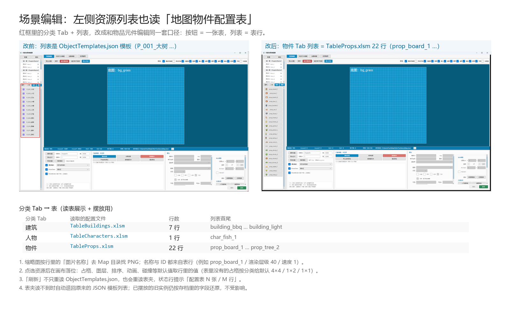
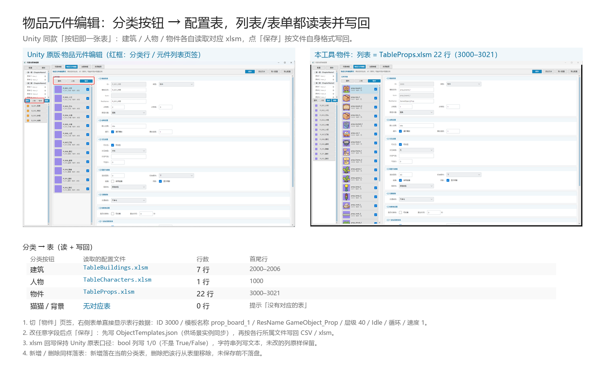
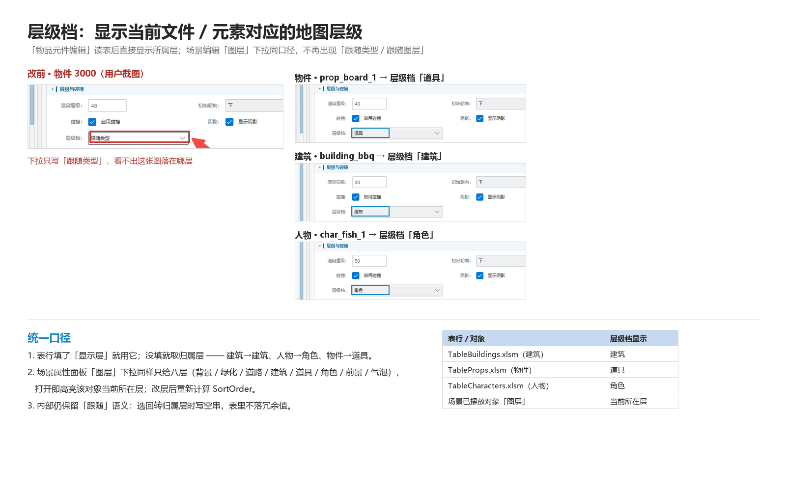

# MapEditorTool —— 场景地图编辑器（独立桌面版）

复刻自 Unity 工程 `CatGameCodeOptimizationBuild/Assets/Scripts/Editor/MapTool`（原 `SenceMapTool` 编辑器窗口），
把「场景编辑」这条主线搬到独立桌面程序，不依赖 Unity 编辑器即可打开、摆放、预览和导出与 Unity 侧
`MapConfigData` 完全一致的 JSON。

技术选型：**.NET 10 + Avalonia 12（窗口/控件）+ 自绘 DrawingContext（地图画布）**。
选择理由是：Avalonia 跨平台、UI 控件齐全（ScrollViewer/ComboBox/Tab 全部原生），地图画布用 Avalonia 自带的
`DrawingContext` 就够用，省掉 SkiaSharp 这一层依赖；PSD 解析则完全不引入第三方库。

### 界面风格

配色按 TexturePacker GUI 的浅色皮肤取色落地（`App.axaml` 统一走 `RequestedThemeVariant="Light"`）：

| 部位 | 色值 | 说明 |
| --- | --- | --- |
| 窗口 / 工具条 | `#F0F0F0` | 浅灰 chrome |
| 左侧面板 | `#EAEAEA` | 整列收进一张分区卡（1px `#BFBFBF` 描边 + 3px 圆角），与主工作区区分 |
| 面板 / 属性区 | `#FCFCFC` | 近白底卡片（1px `#CDCDCD` 边框 + 3px 圆角） |
| 输入框 | `#FFFFFF` + `#ADADAD` 1px 边 | 白底输入区 |
| 按钮 | `#E3E3E3` + `#ADADAD` 1px 边 | 悬停浅蓝 `#D5E9F6`，按下 `#BBDBEF`；文字水平/垂直居中（`App.axaml` 全局 `Button` 样式统一 `HorizontalContentAlignment` / `VerticalContentAlignment = Center`） |
| 强调色 / 选中态 | `#1387BE` | 模式 Tab、主按钮、分区标题 |
| 画布工作区 | `#065A7A` | 地图外区域，深青打底 |
| 地图底面 | `#0784B6` | 与截图画布同色系 |
| 网格线 | 白色 20% / 40% 透明度 | 主次两级，随缩放抽稀 |
| 状态栏 | `#0C7AAC` | 蓝底白字，同截图底栏 |

滑动列表统一走「经典箭头滚动条」：14px 常显灰轨道（`#EDEDED`）+ 上下 ▲/▼ 重复按钮（`#E8E8E8` 底、`#D4D4D4` 分隔线、`#5A5A5A` 三角）+ 蓝灰滑块（`#A9C6D8` 底 / `#7FA8C0` 边 / 2px 圆角）；
色值集中在 `UiTheme.ScrollBar`，与 `App.axaml` 的系统滚动条模板同套，自绘控件不再各写 RGB。
主窗口文字、强调色、选中行与状态提示同样复用 `UiTheme.TextPrimary / TextSecondary / Accent / RowSelectedBack / Chrome`，`MainWindow` 不再维护局部画刷副本。
属性卡「ID 来源」三态徽标与收集物浮窗也走具名主题：`UiTheme.IdSource`（无 / 配置 / 切片）与 `UiTheme.CollectiblePanel`（统计、汇总卡、素材行）。
左侧章节树与资源缩略图走 `UiTheme.LeftPanel`；`MainWindow*.cs` 已不再直接 `Color.Parse` / `Color.FromRgb` / `new SolidColorBrush`。
箭头按 48px 步进、轨道点击翻一屏、滑块可拖拽；左侧「章节列表 / 资源列表」和属性卡「属性」区都由自写控件 `Assets/Honor/Runtime/Controls/Common/ClassicScrollBar.cs` 提供（始终占位，无溢出时滑块铺满整条），
属性区与右栏「物体编辑」滚动条因此完全同款；其余 `ScrollViewer` 走 `App.axaml` 的 `ClassicVScrollBar` / `ClassicHScrollBar` 主题（同样带常显箭头，`AllowAutoHide=False`）。
主题里的 `Track` 必须把 `Minimum / Maximum / Value / ViewportSize` 用 `TemplateBinding` 绑到模板父级，竖向再设
`IsDirectionReversed="True"`：否则 `Track` 拿到的是默认值，滑块会长度不变、位置贴在轨道底部且滚动时反向移动。

表单文字统一按行高做垂直居中：`TextBox.field` 用 `VerticalContentAlignment=Center`，并在模板里的 `TextPresenter`
补 `Margin=0,2,0,0`，把数字 / 中文墨迹从 Fluent 默认的上沿压回 24px 框的视觉中线；
`ComboBox` 额外压模板内的 `ContentPresenter`、单独给可编辑下拉框内部的 `TextBox` 设居中，并让 `ComboBoxItem`、`CheckBox` 统一 `MinHeight=24`。
Fluent 的下拉框默认把选中文本贴到框顶，会出现「动画名称 / 动画来源 / 摆放模式」这些值浮在上沿、和左侧标签不在一条中线上的问题。
`TextBlock.lbl` 不再额外加底部 padding 上提：标签与文本框内容现在共用同一条真实中线，
实测 `ID / X / Y / 宽 / 高 / 层级` 的文字墨迹中心与 24px 框中心一致（如 `ID` 文字中心 `1103` = 框中心 `1103`），不会再出现数字偏高半个字。

列表行统一为「卡片行」：`Height=32`、`Padding=6,0`、行距 `Margin=0,0,0,3`、1px `#ADADAD` 描边 + 2px 圆角、浅灰底，
文字水平/垂直居中，选中时底色 `#381387BE` 叠加、描边转 `#70B4DA`。左侧「章节列表 / 物件列表」两列行高、行距、描边一致；
物件行额外用叠层 `Grid` 在最左侧放 18px 图层色块（`ZIndex=1`，不占文字居中空间）。

界面分区加框，层级一眼能看出来：左侧整列（`配置`/`删除` + 章节列表 + 建筑/人物/物件 Tab + 物件列表）收进一张
`Border Classes="frame"`（`#EAEAEA` 底 + 1px `#BFBFBF` + 圆角 3、`Margin=5`），里面两段列表各自是「白底 + 1px `#D6D6D6` + 圆角 2」的小卡，
于是形成「窗口底 `#F0F0F0` → 分区卡 `#EAEAEA` → 列表卡 `#FFFFFF`」三层；窄窗口下卡片内边距会吃掉宽度，
所以左栏由 193 加宽到 203，`配置/删除` 与 `刷新` 按钮才不会被挤到框外。
右侧同步加框：顶部 Tab 条补 1px `#D2D2D2` 下边线、场景工具条改用 `frame` 卡（`Margin 4`、白近底 `#FAFAFA`）、
画布外框加 `#A9B7BE` 描边 + 圆角 3，图层勾选行 `Spacing` 由 5 收到 4 以免「包围盒」贴边；左侧与主区之间那根 3px 分隔条由 `#D2D2D2` 调浅到 `#DCDCDC`，
避免和分区卡描边叠成两条线。样式集中在 `App.axaml`：`Border.card`（内容卡）、`Border.frame`（分区卡）两级。

四个面板的滑动列表共用控件 `Assets/Honor/Runtime/Controls/Common/ListRowCard.cs`（`IsSelected` 属性驱动选中/悬停态，行距、描边、色值集中一处）：
「元件列表」行高 62（52px 缩略图）、「未配置资源列表」行高 46（36px 缩略图）、「迷雾区域列表」行高 40（两行文字）。
「未配置资源」左卡片改为 `Grid` 六行（标题/扫描/分类/过滤/计数/预览 `Auto` + 列表 `*`），滚动区因此占满卡片剩余高度，
箭头与轨道贴到卡片上下边，不再是固定 300px 上方留白。
「元件列表」（物品元件编辑）与「迷雾区域列表」（迷雾编辑）同样从 `StackPanel` 改为 `Grid` 的 `Auto,*`：`StackPanel` 给子元素无限高度，
列表会冲出卡片底部（滚动条被截断），改后列表被限制在卡片内并自带裁剪，行再多也只是内部滚动。
未配置资源的 170px 预览框：宿主从 `StackPanel` 改成 `Grid`，`Image` 用 `Stretch=Uniform` 等比缩放。
`StackPanel` 给子元素的是无限高度，图片按原始尺寸测量后会超出 170px 框，被 `ClipToBounds` 裁成局部
（比如 `bg_road_5` 只看到四分之一圆弧）；换成 `Grid` 后拿到的是有限高度，整张贴图会完整缩进框里（宽图上下留边、高图左右留边）。
预览框仍保留 `ClipToBounds`，防止极端尺寸溢出盖住下方列表。

三处面板内列表的滚动区补齐「描边外框 + 14px 箭头条」，与左侧章节/物件列表完全同构：
`Border(#C9C9C9 1px)` 包一层 `Grid ColumnDefinitions="*,14"`，左列 `ScrollViewer`（`VerticalScrollBarVisibility=Hidden`，
不能用 `Disabled`——会连带禁用滚轮）承载行卡片，右列挂自绘 `ClassicScrollBar`（代码里 `new ClassicScrollBar { Target = list }`，与 `Assets/Views/MainWindow/MainWindow.axaml` 里
`Target="{Binding #ChapterScroll}"` 等价）。

「已配置资源」表改成**冻结表头 + 只滚数据行**，并按 Unity 配置表的 Excel 样式重排：
表头拆成四行（分组标题条 / 列名 / 字段类型 / 中文注释），数据行单独放进内层 `ScrollViewer`
（`Vertical hidden`），表头挂在同一棵 `Grid` 的第 0 行、数据挂第 1 行，右侧第 1 列固定 14px 挂
`ClassicScrollBar`——表头与数据区拿到的可用宽度完全一致，冻结列不会错位，右侧也不留空白缝
（早期版本把表头塞进横向 `ScrollViewer` 再套一层 `*,14` 网格，`Auto` 列不拉伸，右边就多出一条白缝）。
14px 那条 `ClassicScrollBar` 再包一层 `barLane` 并 `Grid.SetRowSpan(barLane, 2)`，跨「表头 + 数据」两行：
箭头条上箭头与分组标题条顶齐平、下箭头贴表格底边，右上角不会空出一块白槽（只放数据行时，表头右侧会缺一块）。
列宽集中在 `TableColumns` 常量（`84,92,80,104,88,44,50,76,*,100,88,92,58`），第 9 列 `*` 留给
`DialogBubble`（窗口拉宽时由它吃掉余量），其余固定——固定列不会因内容长短跳动，横移/冻结都不错列。
表头四行高度集中在 `TableHeaderRows`（`28,26,22,24`）：早期用 `20,20,18,20` 时 12px 粗体与 11px 列名的
行盒比行高还高，超出的下沿被下一行白底盖住，看上去「上、下各被切掉一截」，行高放大到 28/26/22/24 后四行才完整可读。
表头观感照 Excel 配置表：分组标题条底 `#C5D9F1`、列名行白底 11px SemiBold、类型行白底 10px 灰字 `#808080`、
注释行底 `#92D050`（黑字 10px），四行间与行内都是 1px 格线；数据行 26 高、白底、右侧/底部 1px `#D6D6D6` 格线
（不再用斑马纹，跟截图一致）。对齐由 `CenteredColumns`（`0,5,6,7,9,10,11,12` = 序号 / Loop / Speed / SortOrder /
ShadowEnabled / IsCollectible / RespawnTime / 操作）控制：这些列的数据 `TextBox.TextAlignment = Center`、表头的列名
/ 类型 / 注释三行 `TextAlignment = Center`，文字列（ImagePath / ResName / TemplateName / AnimName / DialogBubble）保持左对齐
——否则 `1`、`0` 会贴着单元格左边线，看起来不像「落在这一列里」。单元格编辑器去掉自身边框（透明底 + `MinHeight=0` + `Height=22`）避免 Fluent
`TextBox` 的 32px 最小高把行撑开；只读 ID 列灰字；「删除」按钮改成浅红底 + 红字细边、20 高 11px。
表格列序与 Unity 配置表对齐：`TemplateId / ImagePath / ResName / TemplateName / AnimName / Loop / Speed /
SortOrder / DialogBubble / ShadowEnabled / IsCollectible / RespawnTime`，比旧版补了 `AnimName`、`ShadowEnabled`
两列（`ObjectTemplate` 早就有这两个字段、`TemplateStore` 的 CSV 列定义也已覆盖，补列只动 UI，保存时照样落 5 张 CSV）。
容器内列表宿主统一 `Margin=4`，行卡片与外框之间留出 4px 缝，观感与左侧一致；无溢出时滑块铺满整条（滚动暗示仍在）。

「九宫格设置」是独立版新增的模板级能力（Unity 原 `ItemElementEditModule` 没有该字段）：
每组字段是可折叠的「需要九宫格」勾选 + 素材预览 + 左/右/上/下四条边距（单位：素材原始像素）+ 中心填充方式（拉伸 / 平铺）。
预览按 Unity Sprite Editor 的绿色切片线口径绘制九宫格：勾选后在图上直接拖动左/右/上/下绿色参考线即可改边距，四个数字框实时同步；取消勾选时预览与边距字段整组隐藏。
未勾选时预览、四条边距与中心下拉整体隐藏（不再占表单高度），勾选后才显示九宫格预览和可拖动绿线。
九宫格只在该素材的摆放实例勾选「是否缩放」时参与绘制：四角固定原尺寸，四条边单轴拉伸，
中心按设置拉伸或按原始尺寸平铺；目标小于「左+右」或「上+下」时自动退回整图拉伸，避免负尺寸。
配置持久化分两层：`ObjectTemplates.json` 写模板自身字段；现有 xlsm 策划表没有这些列，
额外落 `output/Config/NineSliceConfig.json`（按模板 ID / ResName / 图片名多键索引），
保存时表行值也写进旁路文件，下次读表不会被表行默认值覆盖。画布通过 `NineSliceCatalog` 按实例的
`TemplateId / ImagePath / Name` 命中，元件面板每次改边距即时 `Canvas.Refresh()`，无需保存即可看到效果。

图元色同步调亮以适应青色底：建筑 `#E8A23F`、绿化 `#43C08A`、道路 `#9BB0C6`、道具 `#9B8BE8`、
角色 `#FF7FA3`、前景 `#C79A6B`、气泡 `#FFD24A`。选中框为白色 2px 描边 + 黄色 `#FFD24A` 角柄，
在橙/蓝底色上都可辨认。启动时会自动 `FitToView`，不再以固定的 20% 缩放打开。

界面截图（四张面板按 Unity `SenceMapTool.uxml` 的分区布局复刻，配色沿用 TexturePacker 浅色皮肤）：

| 场景编辑 | 物品元件编辑 |
| --- | --- |
|  |  |

| 迷雾编辑 | 资源整理 |
| --- | --- |
|  |  |

---

## 1. 功能清单

### 已实现（场景编辑主线）

| 功能 | 说明 |
| --- | --- |
| 缩放 | 滚轮缩放，锚点为鼠标位置，范围 0.1×～5×，状态栏实时显示缩放率 |
| 平移 | 右键拖拽 / 中键拖拽 / 空格 + 左键拖拽 |
| 自动适配 | 启动时自动 fit 到整图；窗口尺寸变化时重新 fit；「刷新画面」只重绘，不重置视口 |
| 摆放网格 | 菱形网格 / 矩形网格切换（`drawShape`），网格始终压在图层之上。菱形按 TileMap 的 45° 角网格逐格绘制，屏幕线距小于 2 设备像素时才按 2 的幂抽稀（`DiamondGridFactor`），10% 缩放下仍保持逐格密集斜线。网格范围恒等于地图矩形（`0,0,Width,Height`），菱形行列数走 `DiamondLattice.Cols/Rows`（行距半格 → 约为正交格的两倍），改宽高立即重铺；**菱形模式下两组 45° 斜线的截距相位取半个线距**，即整张网格相对格子原点向右下平移半格，边缘不再是贴边的残格。普通摆放网格使用绿色线（弱线每格、强线每 8 格） |
| 路径网格 | 4 格宽的蓝色粗网格辅助线；进入路径绘制时自动打开并同步顶部「路径网格」勾选框，退出后保留当前勾选状态，可随时手动关闭 |
| 图层显隐 | 背景 / 绿化 / 道路 / 建筑 / 道具 / 收集物 / 角色 / 前景 / 气泡 独立开关，另有包围盒开关；收集物开关只作用于 `isCollectible` 实例 |
| 图片边框开关 | 场景设置卡的 `DrawBorder` 勾选项（`Assets/Views/MainWindow/MainWindow.axaml` 的 `DrawBorderToggle` → `MapCanvas.ShowImageBorder`）：勾选时每个图元画 1px 黑色（44% 透明）外框 + 白色占格描边、背景层画虚线框；取消后只剩贴图本身，便于比对美术效果。包围盒（整张地图外框）不受它影响，仍由工具栏「包围盒」单独控制 |
| 裁剪越界开关 | 场景设置卡的「裁剪越界」勾选项（`ClipOutsideMapToggle` → `MapCanvas.ShowClipOutsideMap`，默认开启）：勾选时 ground / traffic / upper / traffic markers 美术和选中框统一裁到地图 `0,0,Width,Height`，边角 605×351 的 `bg_grass_2` 只画地图内部分；取消后完整显示越界美术与实例包围盒，便于检查边缘出血。只影响显示，不改实例坐标 / 尺寸 / 分层数据 |
| 包围盒 | 工具栏「包围盒」勾选后给**整张地图**（`0,0,Width,Height`）套一圈纯绿 `#00FF00` 实线外框，口径与 Unity 场景工具的 `Gizmos` 边框一致（见 `docs/bounding-box-map-frame.png`）。画法在屏幕空间做：把地图矩形用 `ViewMatrix` 换算成设备像素后取整，四条边各 `FillRectangle` 一条 1 像素实心条，并 `PushRenderOptions(EdgeMode.Aliased)`，所以任何缩放下都是 1 设备像素的实心纯绿线，不会被缩放拉粗、也不会和底色混成半透明。注意它与「图片边框」「选中框」是三层独立的东西：选中框是白实线 + 黄色手柄（跟物体旋转），图片边框是每图元的虚线框，包围盒只描地图边界 |
| 摆放 | 左侧资源列表点选模板 → 画布点击落位，自动吸附到 32px 格子；列表按分类 Tab 直接读「地图物件配置表文件夹」里的表行（建筑 / 人物 / 物件各一张表），没有对应表时退回 JSON 模板 |
| 收集物计划 | 顶部「添加收集」两步向导（目标数量 → 最多 12 种素材），完成后打开可拖动、可停靠到画布左 / 右边缘且宽度可拖动的「收集物」面板；支持点选 / 拖放手动摆放、按剩余目标随机生成、清空实例、物件上 / 物件下切换；独立图层可显隐，计划与实例随 JSON 存档（见第 2 节「收集物计划」） |
| 选中与编辑 | 点选 / 框选 / 拖拽移动，右侧属性面板同步（数字 ID、分层 Tag、格子坐标 X/Y、格子宽高、排序、显示层、交互类型、碰撞、阴影、可收集、参与交通、朝向）；右栏「物体编辑」另有旋转（度）/ 大小（像素）/ 是否缩放三项，跟着选中实例回填与提交，整块显隐由属性行的「编辑」勾选框控制 |
| 格子点选 | 左键点在**没有物体**的地方 → 选中该格（菱形模式按 `DiamondLattice.Center` 换算、矩形模式按正交格），绿色填充 `#4CD964`（40% 透明）+ `#2EC44A` 描边，压在网格与图元之上，边缘严格落在网格线上；地图外空白处不选中。`MapCanvas.SelectedCell` / `CellSelectionChanged` 对外广播，场景设置提示行回显「已选中格子 [列, 行]」，点到物体或按 `Esc` 自动清除 |
| 删除 | `Delete` 键或属性面板「删除」按钮 |
| 路径绘制 | 选中**任意已放置物件**（角色 / 建筑 / 物件 / 载具）后点「开始绘制路径」显式进入；进入后自动打开蓝色路径网格，**左键点地面 / 空白直接加点**，点到其他树 / 建筑 / 道具**一律忽略**，不切换选中、不拖动、不换目标；`Ctrl+右键` 撤销最后点，另有清空路径与停止绘制。想选其他物件先停止绘制或按 `Esc` 退出。路径加点走独立的 `ObjectHitKind.PathPoint` 命中：包围盒内还要读取精灵 alpha，建筑透明留白可以落点，真实墙体 / 树冠仍拒绝 |
| PSD/PSB 导入 | 自写零依赖解析器（图层结构 + 像素通道 RAW/RLE 解码），读取图层名、边界、可见性、不透明度、混合模式、分组层级，自动按 `psd_import.py` 规则归类八层；贴图按 PSD 每层像素**自裁切片**（不依赖 Unity 清单的复用决策），整幅图层与背景地块合成为 `Background\bg_{PSD 名}.png` 底图 |
| JSON 导出 | 文件名 = 场景 ID，字段名与 Unity `MapConfigData` 逐项对齐 |
| 状态栏 | 缩放率、鼠标世界坐标、所在格子、格子数、网格尺寸、保存路径；整条内容 `VerticalAlignment=Center` 在蓝条内上下居中 |
| 物品元件编辑 | 模板全字段编辑（9 个折叠分组）、三类型 Tab、按分类读「地图物件配置表文件夹」并写回、增删改、无表时退回 JSON 模板、模板改动同步到场景实例（见第 3 节） |
| 交通规则 | **标记人行道 / 标记道路 / 标记横道 / 标记红绿灯**四个动作：先在画布上选中已有物件，再由右栏按钮或快捷键打标记 / 取消标记；不再有刷格、画横道工具。人行道 / 道路按物件包围盒展开成 `sidewalkCells` / `roadCells` 并写一条 `regions` 记录，横道按包围盒长边生成 A/B 点，红绿灯按脚底锚点登记；实例侧含是否载具、交通角色、停止线、绑定红绿灯、黄灯策略（见第 2 节）。区域只描整块区域的**外轮廓**（人行道青、道路浅灰蓝，1.2 设备像素），不填半透明底色 |
| 迷雾编辑 | 笔刷大小与透明度、开始/停止绘制、区域列表、添加/清空区域（见第 4 节） |
| 资源整理 | 扫描未配置 PNG、六分类过滤、预览与补字段、写入配置表、已配置表就地编辑与删除（见第 5 节） |
| 遮挡带手改 | 选中即显示这张图的层级（第几层 / 带内第几位 / `sortOrder` / 图层与 PSD 层名）；改「遮挡带」下拉或直接改「层级」数字即可把它挪到另一带，画面立即重排（见第 2 节「选中即显层级」） |
| 章节 / 关卡树 | 启动时从「章节配置表」「主关卡配置表」（xlsm）读出章节名与关卡，画成可折叠的树；关卡行带存档徽标（文件大小 / 空），点关卡按 `{章节名}-关卡{关卡ID}` 起场景并载入 `Map_{章}m{关}.json`（见第 2 节「章节树」） |

### 与 Unity 原工具的对应关系

| 原工具模块 | 本工程 |
| --- | --- |
| `SenceMapTool.uxml` / `.uss` | `Assets/Views/MainWindow/MainWindow.axaml`（203px 左栏 + 主区 + 底部属性横排，按 uxml 复查复刻） |
| 底部三栏 | 420px 场景设置 / 自适应「对象编辑」/ 900px「属性」+ 280px 交通设置，三张等高卡片（高 336） |
| `SceneEditModule` | `Assets/Honor/Runtime/Controls/Canvas/MapCanvas.*.cs` + `Assets/Views/MainWindow/MainWindow.*.cs` 的场景编辑部分 |
| `ItemElementEditModule` | `Assets/Honor/Runtime/Controls/Panels/ItemElementPanel.cs` + `Assets/Honor/Runtime/Services/Templates/Store/TemplateStore*.cs`（模板 CRUD 与配置表读写） |
| `ObjectTemplateManager` / `TemplateFieldView` | `Assets/Honor/Runtime/Services/Templates/Store/TemplateCatalog.cs`（19 个内置模板）+ `Assets/Honor/Runtime/Models/Template/TemplateDisplay.cs`（枚举显示名映射） |
| `TemplateConfigReader` / `TemplateConfigWriter` | `Assets/Honor/Runtime/Services/Templates/Store/TemplateStore.Csv.cs`（29 列兼容 + 4 扩展列） |
| `TemplateIdGenerator` | `Assets/Honor/Runtime/Services/Templates/Store/TemplateStore.cs` 的 `NextTemplateId()`（人物 1000+/建筑 2000+/物件 3000+） |
| `MapToolModels.cs` | `Assets/Honor/Runtime/Models/Core/EditorModels.cs` |
| `MapToolConstants.cs` | `Assets/Honor/Runtime/Models/Core/EditorModels.cs` 的 `MapToolDefaults` |
| `common/psd_import.py` | `Assets/Honor/Runtime/Services/Psd/PsdReader.cs`（自写解析器）+ 导入归类逻辑 |
| `MapDataLuaExporter.cs` | `Assets/Honor/Runtime/Services/Map/MapJsonService.cs`（JSON 部分） |
| `AtlasPacker`、`PsdImportModule` 的切片出图 | 未复刻（依赖 Unity 的 Sprite/AssetDatabase 管线） |

### 尚未实现

- AtlasPacker（官方 TexturePacker 1:1 复刻）
- Lua 导出、导出切片、Unity Sprite 预览

场景编辑 / 物品元件编辑 / 迷雾编辑 / 资源整理四个面板均已实现，不再有占位页面。

---

---

## 2. 场景面板：布局与交通规则

### 面板纵向结构

场景面板只有四行（`ScenePanel` 的 `RowDefinitions="Auto,*,Auto,Auto"`），画布独占中间那条 `*`，窗口拉高时全部增长都落在画布上：

| 行 | 内容 |
| --- | --- |
| 0 | 场景工具条 `frame` 卡：导出设置 / 保存 / 清空摆放物 / 清空格子数据 / 地图预览 / 导入 PSD，右侧一组图层勾选与「包围盒」 |
| 1 | 画布（`MapCanvas`，`#CFD8DC` 底 + `#A9B7BE` 描边 + 圆角 3，`ClipToBounds`） |
| 2 | 蓝底状态栏（缩放率 / 鼠标世界坐标 / 格子坐标 / 格子数 / 网格尺寸 / 保存路径 + 「…」选目录） |
| 3 | 底部三栏 420 + `*` + 900、高 336 的卡片区 |

> Unity 的 `SenceMapTool.uxml` 在画布上方还有一条「地图预制体」行（下拉 + `⤢` + 目录提示）。独立版**已整行删除**：
> 这条行常驻会白占 30 像素，且它的存档切换只是调试期的对照手段。现在打开存档走命令行 `--open-map <json>`，
> 启动落的是空场景（`TemplateCatalog.CreateEmptyMap()`：4096 × 4096、32px 格子、菱形绘制、底图 `bg_grass`、0 物件）。
> 对照图见 `docs/scene-panel-no-prefab-row.png`。

### 左侧资源列表：分类 Tab 直接读配置表

场景编辑左上角的 `建筑 / 人物 / 物件 / 刷新` 与下方资源列表，和「物品元件编辑」共用同一套映射：



| 分类 Tab | 读取 | 列表内容 |
| --- | --- | --- |
| 建筑 | `TableBuildings.xlsm` | building_bbq / building_bread_1 … building_light（7 行，2000–2006） |
| 人物 | `TableCharacters.xlsm` | char_fish_1（1 行，1000） |
| 物件 | `TableProps.xlsm` | prop_board_1 / prop_box_1 … prop_tree_2（22 行，3000–3021） |
| 刷新 | 重读表夹 + `ObjectTemplates.json` | 状态行提示「配置表 N 张 / M 行」 |

- 列表项的缩略图按行里的「图片名称」去 Map 目录找 PNG，找不到退回图层色块；
- 点选后照旧在画布落位：占格、图层、排序、动画、碰撞等默认值都取行里的值（表里没有的占格宽高按分类给默认：建筑 4×4、人物 1×2、物件 1×1）；
- 表夹读不到时自动退回原来的 `ObjectTemplates.json` 模板列表，不影响已有存档打开。

### 收集物计划：顶部「添加收集」→ 可停靠到画布左 / 右边缘

收集物不是新的 `MapObjectType`，仍是 `Type = Prop` 的 `PlacedObject`；靠既有的 `isCollectible` 字段标记，
另加 `collectibleOverObjects` 表示它显示在普通物件上方还是下方。这样 Unity 端对象类型 / 导出结构不用改。

1. 顶部工具条点绿色 **「添加收集」**，弹出两步向导 `Assets/Honor/Runtime/Controls/Windows/CollectibleWizardWindow.cs`：
   - 第一步照参考图一：当前地图卡片 + **目标数量**（默认 50）+ **显示层级**（物件上 / 物件下）；
   - 第二步照参考图二：12 个已选槽位 + 物件表素材网格（`TableProps` 行，最多 12 种），点素材加入、点角标移除；
   - **「开始制作」** 只有在至少选中 1 种素材后才可用；完成后写回 `config.Collectibles` 并打开浮窗。
2. 左侧分类 Tab 恢复为 **建筑 / 人物 / 物件 / 刷新** 四列；收集物不再占用切页。
   顶部绿色按钮文案变为 **「收集物」**：点一下打开 / 收起浮窗；没有计划且没有 `isCollectible` 实例时仍显示 **「添加收集」**。
3. 浮窗（参考图二 `TextureSettings` 样式）：
   - 浅灰标题栏 + 白色内容区，标题栏可按住拖动；`重设` 重新打开向导、`吸附 / 浮动` 切换贴边状态、`×` 关闭面板；
   - 拖到画布 **左缘或右缘 28px 内**松手即停靠：面板贴边铺满画布可用高度、去掉圆角与阴影，只留靠画布一侧 1px 分隔线；
   - 停靠时 `MapCanvasHost` 同步让出面板宽度（右侧停靠左边距 = 面板宽，左侧停靠右边距 = 面板宽），画布按剩余区域重新适配，不再被面板压在下面；
   - 停靠后靠画布一侧出现 6px 宽拖动条，左右拖动可调整停靠宽度（300–520px），画布实时让位；`浮动` 恢复可拖动浮窗；
   - 顶部三格统计 **目标 / 已放 / 剩余**，下面是层级下拉（物件下 / 物件上）；
   - **随机生成剩余 R 个**：按现有实例包围盒建占用格，在空白格取样，每种素材随机挑；空间不足时只生成能放下的数量并在状态栏提示还差多少；
   - **清空收集物**：删除所有 `isCollectible` 实例，保留目标数量与已选素材，方便重新随机；
   - 每种素材一行（图标 + 名称 + 已放数量），支持 **点素材再点地图** 和 **按住素材拖到地图松开** 两种手动摆放；
     点击落点允许压在已有物件上，不需要先清空地面；这两种动作都不要求先勾选底部「摆放模式」。
   - 浮动高度按素材数量自适应（1 种约 300px，12 种最多 600px）；停靠后跟随画布高度并随窗口缩放保持贴边。
4. 层级与显隐：
   - 顶部图层开关保留 **「收集物」** 复选框，和普通「道具」开关分离；关掉只隐藏收集物，不影响普通物件；
   - 绘制顺序仍由 `LayerOrder` 统一决定：`CollectibleRank` 把同一立体带拆成 `0 = 物件下 / 1 = 普通立体物 / 2 = 物件上`，
     组内继续按脚底 Y 排序，所以「物件上」不会越过前景 / 气泡层变成假前景。
5. 存档口径（`MapJsonService` / `MapJsonLoader`）：
   - 顶层：`collectibleTotal`、`collectibleLayer`（`under` / `over`）、`collectibleKinds[]`（每种素材的
     `templateId / name / imagePath / resName / width / height / layerType / animName`）；
   - 每个收集物实例：`isCollectible: true` + `collectibleOverObjects: true/false`；
   - 重新打开地图时先读计划；若是没有顶层计划的老档，则从现有 `isCollectible` 实例反推素材并补齐目标数量，
     面板内容仍能恢复，再点顶部「收集物」即可打开。

### 地图配置（左上「配置」按钮）

Unity 的「配置」按钮弹出 `MapConfigWindow`（uxml 3–46 行）。独立版 1:1 复刻成模态弹窗 `Assets/Honor/Runtime/Controls/Windows/MapConfigWindow.cs`，
六条路径 + 基线步长，默认值与 Unity `MapToolConstants` 逐条对齐；uxml 里的「地图预制体」行不复刻（场景面板那条行也已删除）。


| 行 | 默认值 | 独立版里实际做什么 |
| --- | --- | --- |
| 章节配置表 | `../Docs/Designs/Excels/Tables/AlTables/LevelConfigs/TableChapters.xlsm` | 记录口径（Unity 用它读 xlsm 章节表；独立版没有 xlsm 解析，留给后续接表） |
| 主关卡配置表 | `../Docs/…/TableMainLevels.xlsm` | 同上 |
| 物体预览图目录一 | `Assets/Res/Prefabs/Map/Objects` | 解析成工程内绝对路径后追加进 `AssetLibrary` 搜索根，元件图标 / 物件贴图优先在这里找 |
| 物体预览图目录二 | `Assets/Res/Textures/Map/Objects` | 同上 |
| 分区背景图目录 | `Assets/Res/Textures/Map/LevelBackground` | 同上（`bg_grass` 等底图按 `{bgName}.png` 命中） |
| 地图保存目录 | `Assets/GameData/Maps` | 只记录口径；本工具落盘到工程根的 `docs\MapJson`（状态栏可改目录），不会往 Unity 工程里写文件 |
| 基线步长 | `10` | 随地图 JSON 的 `baselineStep` 落盘；当前独立版与 Unity `MapToolConstants.LayerBaselineStep` 对齐，层号固定按 10 计算（改这个值只保存，不改变已有排序） |

细节：

- **路径口径**：工程内写 `Assets/…`，Assets 之外的写 `../…`（都相对 Unity 工程）；选文件 / 选目录后自动转相对路径，
  工程外的选择保留绝对路径。选择器初始目录取当前配置所在位置，找不到时退回 `Assets`。
- **落盘**：确定写 `output\Config\EditorSettings.json`（`Assets/Honor/Runtime/Services/Infrastructure/EditorSettingsStore.cs`，替代 Unity 的 EditorPrefs），
  启动时装载；取消不改任何设置。文件缺失或损坏时回落默认值并立即重建，不阻塞启动。
- **校验**：基线步长填非数字按当前值回退、越界按上下限钳制，此时底部提示行变红并说明实际取值，窗口不关闭。
- **生效范围**：基线步长只随配置保存，当前不改变层号坐标（固定 10，与 Unity 对齐）；改「遮挡带 / 图层 / 位置」才会改变画面。

### 交通规则列

属性面板右侧一列交通规则（对应 uxml 中属性区右半部），自上而下：**交通标记**（2×2 共四个按钮：标记人行道 / 标记道路 / 标记横道 / 标记红绿灯）、
**实例属性**（是否载具 / 黄灯按红灯 + 交通角色 / 停止线 / 绑定红绿灯 + 红绿灯列表）。

**交通分组常显**（`TrafficDrawGroup`）：标记属于地图级操作，不随选中实例的「交通」勾选隐藏。
未选中任何实例时四个按钮禁用并提示先选物件；选中后每个按钮独立判断是否已带该标记，已带时显示「取消人行道 / 取消道路 / 取消横道 / 取消红绿灯」。
这样选中 `Interactable = false` 的灯体或道路美术物件时，按钮也不会消失。

窗口高度有限时整列内容会溢出（原实现下底部「绑定红绿灯」与列表会被窗口下沿裁掉），因此这一列外层套了
`ScrollViewer`（`x:Name="TrafficScroll"`，`VerticalScrollBarVisibility="Hidden"` 关掉系统条）+ 右侧 14px
「经典箭头滚动条」（`controls:ClassicScrollBar Target="{Binding #TrafficScroll}"`，与左栏章节/资源列表同款）：
滚轮、拖拽滑块、点击 ▲/▼ 都能上下滚；分组标题（交通标记 / 实例属性）在滚动中作为分节提示始终随内容移动，
顶部 2×2 按钮左右对齐。列表本身不再嵌套第二层 `ScrollViewer`（嵌套会抢滚轮），统一交给外层滚，列表随条目增高、面板整体滚动。

窗口拉高到内容放得下时滑块铺满整条（设计如此，滚动暗示常驻）。

| 动作 | 快捷键 | 行为 |
| --- | --- | --- |
| 标记人行道 | `F1` | 选中物件后按 `F1` 或右栏按钮：用**物件 ID 作为区域 ID**，把包围盒换算成格矩形，写入一条 `regions`（`type = sidewalk`）并把覆盖的格子补进 `sidewalkCells` |
| 标记道路 | `F2` | 同上，区域类型 `road`、格子写进 `roadCells` |
| 标记横道 | `F3` | 选中物件后按 `F3`：用物件 ID 作横道 ID，包围盒长边作 A/B 点、短边作 `width`，长边水平则 `direction = horizontal`，否则 `vertical`；6 格内若有空闲红绿灯会同时双向绑定 |
| 标记红绿灯 | `F4` | 选中灯体物件后按 `F4`：灯 ID 直接复用物件 ID，锚点取包围盒**底边中心（脚底）**，并在 6 格内自动绑定最近横道。已标记时按钮变「取消红绿灯」，再次触发即删灯并清反向引用 |

四个动作都遵循同一套「选中物件 → 标记 / 取消」口径：

- **一个物件只保留一种交通标记**：给已带道路标记的物件打人行道/横道/红绿灯标记时，会先清掉旧标记再写新的，状态栏提示「已清理该物件的其他交通标记」；避免同一物件既算道路又算人行道。
- **标记后立即生成真实数据**：人行道/道路不只打 UI 标记，会真正写 `regions` 与 `sidewalkCells` / `roadCells`；横道会写 `crosswalks` 的 A/B/宽/方向；红绿灯会写 `trafficLights`。保存后 `MapJsonService` 原样落盘，`--open-map` 读回时按物件 ID 恢复按钮状态。
- **取消标记只删自己那一条**：人行道/道路取消时删对应 `regions` 记录，并只清理不再被任何同类型区域覆盖的格子；与别的物件区域重叠的格子会保留，避免误删别人的范围。横道取消时清掉挂在这条横道上的灯 `boundCrosswalkId`；红绿灯取消时清实例 `boundLightIds` 与横道 `boundLightId`。
- **移动 / 缩放 / 改名自动同步**：`SyncObjectBackedTrafficAreas()` 按最新包围盒重算区域矩形并迁移格子；`SyncObjectBackedCrosswalks()` 重算 A/B、宽度、方向并同步绑定灯的朝向；`SyncObjectBackedTrafficLights()` 同步名称、脚底锚点、图片、动画名。
- **删除物件清全部交通数据**：`BtnDeleteObject` 删除前会调用 `RemoveObjectBackedTrafficMarks()`，把该物件名下的灯、横道、人行道、道路标记一起清掉，不留指向空物件的悬挂记录。
- **不再叠画工具假象**：物件型红绿灯跳过三色假灯；物件型横道跳过斑马条纹与黄色中线，由物件自身贴图显示。旧地图里独立放置的灯 / 横道仍按旧逻辑绘制，保持兼容。
- **不做模板类别硬校验**：`prop_lamp_2` 的模板交通类别就是 `none`，按类别卡会漏掉真正的灯体；四个标记都允许对任意选中物件执行，靠按钮状态和状态栏提示兜底，误标可立即取消。

实例侧字段：

- **是否载具**：勾选后交通角色自动切「载具」；
- **交通角色**：行人 / 载具 / 不参与（`TrafficRoles.ToDisplay` / `ToCode` 归一）；
- **停止线(X,Y)**：文本 `x, y`，回车或失焦提交，写到 `stopLineX` / `stopLineY`；
- **绑定红绿灯**：列出当前地图的红绿灯，逐条勾选即写 `boundLightIds`；「全选」一次全勾/全清；无灯时显示「（当前地图无红绿灯）」；
- **黄灯按红灯处理**：仅对载具生效，写 `yellowTreatAsRed`。

导出侧 `trafficLights` / `crosswalks` 已从空数组改为真实序列化（`TrafficLightPayload` / `CrosswalkPayload`），
字段名与 Unity 一致；实例对象新增 `isVehicle / trafficRole / stopLineX / stopLineY / boundLightIds / yellowTreatAsRed`。

### 物体编辑

右栏（红框列）末段新增「物体编辑」组，跟着选中实例走：**未选中时整组禁用**（灰底、显示上次值），**选中后回填**该实例的旋转 / 大小 /
是否缩放；三个输入都在回车或失焦时提交，改完立即重画画布并刷新左侧摘要。组在小窗口下随整列一起滚动，滚到底即可见。

属性面板的「碰撞 / 阴影 / 收集 / 交通」行下方新增一个**「编辑」勾选框**（右侧带「显示物体编辑」说明），专门控制这一整块
（分隔线 + 标题 + 三个字段）的显隐：取消勾选就整块收起，右栏只留交通相关分组；勾选则原样展开。它只是界面开关，不写进地图数据，
本次运行内保持状态。因为它在属性卡片里，未选中实例时和其它属性一样是禁用态（此时也谈不上编辑物体）。
对照图：`docs/object-edit-toggle.png`。

| 字段 | 数据字段 | 行为 |
| --- | --- | --- |
| 旋转（↺ / 值 / ↻ / 重置） | `rotation` | 与「物体变换」的角度行同一套四段式：点 ↺ 逆时针 15°、点 ↻ 顺时针 15°，中间显示当前角度（`-15°` 这种写法），「重置」归 0；角度归一到 [-180, 180)，画布上贴图与图片外框一起转，占格描边和选框仍保持轴对齐（旋转不改占格）。命中判定按逆旋转换回局部坐标后再判包围盒，转过角度仍点得中 |
| 大小(px) | `pixelWidth` / `pixelHeight` | 宽 × 高，写像素尺寸并把 `scale` 归 1，保证输入值就是画布上的显示尺寸与占格；只改宽时高沿用当前值，反之亦然 |
| 是否缩放 | `stretch` | 勾选：贴图按「大小」非等比拉伸铺满包围盒；取消：贴图等比缩放到包围盒内居中（contain，等价 Unity 场景工具的 `ScaleMode.ScaleToFit`），宽高比不失真也不溢出包围盒。PSD 导入的实例一律 `stretch=false`，与 Unity 导出的 JSON 一致 |

对照图：`docs/object-edit-panel.png`（改前 / 改后列）、`docs/object-rotation-compare.png`（旋转 0° / 30°）、
`docs/object-edit-rotation-row.png`（旋转行改成 ↺ / 值 / ↻ / 重置 的四段式）。

### 位置(px) 与拖动改值（Unity 式 Scrub）

「位置(px)」行 = 世界坐标 `x` / `y`（像素，相对地图左上角），回车或失焦提交，写回实例后立即重画画布、刷新「格子坐标」。
另外这条行支持**按住左键左右拖动连续调值**，和 Unity 数值框的手感一致：

- 拖动把手有两个：`X` / `Y` 两个小标签，以及输入框本身（框内左键按住拖动同样生效）。
- 位移换算：1 屏幕像素 = 1 个数值；**前 4px 是起拖死区**，所以「按下就跳一格」不会发生；上拖 / 左拖算负、下拖 / 右拖算正。
- 按住 `Shift` 拖动 = 步长 ×10（快速挪半屏），松手即提交。
- 不拖动、只单击 → 仍按普通输入框处理（进入文本编辑，原来的回车 / 失焦提交逻辑不变）。
- 拖动时每帧都写回实例并重画画布（选中框、占格、格子坐标一起跟着走），不是松手才刷新。
- 「大小(px)」的宽高两个输入框也挂了同一套拖动逻辑（1px = 1 像素尺寸）。

对照图：`docs/position-scrub.png`（拖前 X=1288 → 框内右拖 70px 后 X=1354）。

### 碰撞区域 / 阴影区域

属性行的「碰撞」「阴影」两个勾选框现在不只是布尔开关：勾上后右栏会多出对应的「碰撞区域」「阴影区域」分组，
用来把碰撞 / 阴影矩形从「等于整个包围盒」缩小、偏移到实际形状（比如桌椅只有桌腿占碰撞）。

- 显隐规则：`碰撞` 勾选 → 显示「碰撞区域」；`阴影` 勾选 → 显示「阴影区域」；两个都勾选时按「碰撞区域 → 阴影区域」顺序排列；
  取消勾选即整块收起；未选中实例时两块都收起。
- 字段：`XY(px)` = 相对包围盒左上角的偏移，`宽高(px)` = 区域尺寸；**宽或高填 0 表示铺满该方向的剩余包围盒**，
  所以 0/0 是默认的「整块包围盒」。「重置为铺满」一键把 XY 与宽高都归 0。
- 提交方式与「大小」一致：回车或失焦提交，写回选中实例后立即重画画布。
- 画布：碰撞区域画**红色**半透明填充 + 红色虚线框（`#E5533D`），阴影区域画**紫色**半透明填充 + 紫色虚线框（`#7A5CD6`），
  只在选中实例上描绘，缩放时线宽自动跟随（`1.5 / zoom`）。
- 数据：`PlacedObject` 新增 `collisionX / collisionY / collisionWidth / collisionHeight` 与
  `shadowX / shadowY / shadowWidth / shadowHeight`（像素，相对包围盒左上），随 `objects` / `characters` 一起存取。
  Unity 侧原本只有 `CollisionEnabled` / `ShadowEnabled` 两个 bool、没有矩形数据，这两个矩形是本工具新增的口径，
  `JsonUtility` 读图时会忽略未知字段，不影响老工程。

对照图：`docs/collision-area-edit.png`（右栏宽高改 64×64，画布红框随之缩小）。

### 物体变换（收集物专属）

勾选「收集」后，右栏再出现一块「物体变换」，按 Unity `SceneEditModule` 的变换区一行一行复刻（每行都是「标签 + 操作按钮 + 数值 + 重置」四段式）：

| 行 | 操作 | 数据字段 | 口径 |
| --- | --- | --- | --- |
| 层级 | 上移 / 下移 / 置顶 / 置底 | `sortOrder` | 只和**同图层**的实例比较：上移 +1、下移 -1；置顶取同层最大值 +1，置底取最小值 -1，不跨图层 |
| 比例 | － / 100% / ＋ / 重置 | `scale` | 每次 ±10%，夹在 20% ~ 300%（`ScaleMin/ScaleMax`），重置回 1.0；包围盒尺寸整体乘 `scale` |
| 角度 | ↺ / 0° / ↻ / 重置 | `rotation` | 每次 ∓15°（Unity `RotationStep=15`），归一到 [-180, 180) 显示，重置回 0 |

- 显隐规则：`收集` 勾选 → 显示；取消勾选或未选中实例 → 收起。
- 三行都是即时生效：点一次就重画画布并回填数值文本，不写文件也能在画布上看到大小 / 角度变化。

对照图：`docs/object-transform-row.png`（三行按钮 + 「比例 ＋」生效后 100% → 110%）。

### 贴图渲染

画布上的每个实例按 `image` 字段取真实 Sprite 绘制（背景层把 `bgName` 底图整幅铺满），不是只画图层色块：

- `image` 写法与 Unity 一致（`Assets/Res/Textures/Map/.../bg_1.png`），由 `Assets/Honor/Runtime/Services/Resources/AssetLibrary.cs` 解析；
  `output\Config\resRoots.txt` 用一行 `project=<Unity 工程根>` 声明工程根，其余行是额外资源根。
- 解析顺序：绝对路径 → 工程根/资源根 + 相对路径 → 在 `Assets\Res` 索引里按文件名查 → 同名保底。
- 命中就画图，未命中才退回图层色块；占格描边、选中框、名称标签照常绘制，编辑能力不受影响。
- 旋转与水平镜像只作用于内容：贴图与外框在 `ContentTransform(rotation, flipX, bounds)` 里绘制（绕包围盒中心转、先镜像后旋转，与 Unity `T*R*S` 同序），
  选中框（白 2px）、四角黄手柄、碰撞 / 阴影虚线框在**同一个旋转矩阵**内绘制，所以改角度后整框跟着图一起转；
  名称标签与「占格足迹」属于网格 / 排版概念，仍保持轴对齐；「包围盒」已不再是逐物件的黄虚线 AABB，
  改成整张地图的绿色外框（屏幕空间绘制，见上文「包围盒」一行）。
  其中「占格足迹」在「选中且带旋转」时不再绘制——它会和已旋转的选中框错开，看起来像「框没跟图转」。
  对照图：`docs/selection-frame-rotation.png`。
- 位图按路径缓存（上限 320 张，超出整体丢弃重建），500+ 实例的地图缩放平移不卡。
- 想直接核对 Unity 关卡：

```powershell
.\bin\Debug\net10.0\MapEditorTool.exe --open-map "E:\Game\CatGame\CatGameCodeOptimizationBuild\Assets\GameData\MapDatas\Map_1m1.json"
```

  `Map_1m1` 为 128×128 格、542 个实例（12 建筑 + 530 角色/装饰），全部 `image` 均可解析。

### 选中占格落在图片层级下（碰撞占用格）

选中一个实例时会把它的「碰撞占用格」逐格铺出来（矩形模式=正方格，菱形模式=菱形格，见「摆放模式」）。
这层格子**统一画在所有图元贴图之前**（底图之上、任何实例之下），所以只会在没有被美术覆盖的空隙里透出来，
不会整片盖在美术上面——美术永远在格子之上，格子只是「垫在底下」的占格参考。

| 状态 | 占格画法 | 绘制位置 |
| --- | --- | --- |
| 选中实例 | 琥珀格线（`#FFC81E`，2 设备像素）+ 极淡琥珀底（`#FFD24A`，alpha 0x28） | 两组图元循环**之前**统一画一次，被所有贴图盖住 |
| 未选中但带旋转 | 只画一圈淡描边（`#FFD24A`，alpha 0x55），不铺底 | 仍浮在图元之上，仅作提示 |

实现要点（`Assets/Honor/Runtime/Controls/Canvas/MapCanvas.Rendering.cs`）：

- `Render()` 在 `DrawMapLayer()` 之后、两个物件循环（地表格 / 非地表格）之前调用一次 `DrawSelectedOccupancy(context)`；
  它只读 `_selected`，把格子与贴图放在同一条绘制序列里、并且顺序在前。
  早期版本是「在选中实例自己的 `DrawObject` 之前各调一次」，对地被类物件仍会压在树上、人物上，故改为统一垫底。
- **不要把占格包进 `PushClip`**：一旦用 `using var clip = context.PushClip(mapRect)` 圈住这批格子，Avalonia 会把它合成到贴图之上，
  格子又会浮回美术表面（本轮踩过的坑）。越界格子改为在 `DrawOccupancyCells` 里逐格判断：与 `(0,0,Width,Height)` 相交才画。
- 旋转实例的格子集合仍由 `OccupiedCells()` 按「格子中心落在旋转矩形内」计算，与导出 `buildCells` 口径一致。
- 碰撞 / 阴影区域（橙红 `#E5533D` / 紫 `#7A5CD6` 半透明）是另一层含义的提示，仍按原逻辑在选中实例**之上**描绘，两者互不影响。

验证：同一点在「选中 / 未选中」两张截图上逐像素比对——栅栏贴图内部差异 **0.2%**（均值 0.1），即格子确实被贴图盖住；
旧实现同区域被琥珀色洗过（`occ2` 采样 `[94,37,23] → [121,56,67]`）。菱形模式下同样成立（301% 缩放，菱形格只在椅子轮廓外可见）。

对照图：`docs/occupancy-under-image.png`（左：旧「格子浮在贴图上」 · 中：新「格子沉在图片下」 · 右：菱形模式同样成立）。


### 遮挡分层（烘焙 / 导入后的 2D 遮挡规则）

PSD 是一次性把 582 层「按层序」压成一张画，而地图运行时是几百个**独立实例**各自带包围盒穿插摆放。
只要排序不按层序，就会出现「篮子画在店面之前」这类和原画不一致的遮挡。现在用「三带 + 立体带脚底 Y」解决：

| 遮挡带 | 编号 | 归入条件（`Assets/Honor/Runtime/Services/Map/LayerBands.cs`） | 排序依据 |
| --- | --- | --- | --- |
| 地表 | 0 | `background` / `road` / `greenery` 图层；名字含 grass / lawn / floor / tile / carpet / sand / water / sea / road / 沙滩 / 水面 / 地毯 / 草地…，或以 `bg_` 前缀开头 | 八层层序（背景→道路→草地贴花） |
| 立体 | 1 | 其余实例（树、花草、桶、灯、路牌、围栏、喷泉、摊位、建筑、人物、鱼摊…） | **跨图层按脚底 Y**：`包围盒底部 + ySortOffset`，越靠下越靠前；同 Y 才看八层层序 |
| 叠加 | 2 | `foreground` / `bubble` 图层（前景装饰、气泡通用装饰） | 八层层序，永远最上 |

- 英文词按 `_ - . / \` 分词做**整词**匹配（避免 `carpet` 命中 `car`），中文按子串匹配。
- 实例上的 `displayLayer` 若被手改成具体图层名，则该值优先，实现「单个物件手工改分层」。
- **判定优先级**：`BandOverride` → 显式 `building / prop / character` → `foreground / bubble` → `background / road / greenery` →
  只有键缺失或未知时才用名字关键词兜底。这样同样是 `bg_rock_1_550_867`，`layerType=prop` 的副本会进入立体带，
  `layerType=background` 的副本仍留在地表；不要再只看一个 `bg_` 前缀就判死。
- **`greenery` 是绿化层，不是立体组**：`bg_grass_2` 这类大面积草地/树影默认进地表带，先画，不能按脚底 Y 盖到池塘和道具上。
  绿化组里独立的树、灌木仍由下面的窄口提升进立体带；`bg_grass` / `bg_flower` 这类平面花圃不提升。
- **背景组里的独立立体美术**：`background / road / greenery` 里不是整幅底图的层，若名字明确是树、灌木、围栏、建筑、人物等，
  导入与「刷新画面」会自动写 `bandOverride = 立体`；`bg_` 合并层和 `pond / water / road / rug` 等平面词仍留在地表。
  否则围栏（立体）会永远压住背景组里的灌木（地表），放大后就是“立柱切进灌木”的硬直边，不是贴图缝隙。
- **窄缝自动贴合**：下方是 `pond / water / rug / carpet` 这类平面件、尺寸 120–256px，与上方立体件水平重叠 ≥50%、
  垂直只差 1–24px 时，「刷新画面」会把下方件上移这段空隙，让池塘顶边贴住围栏脚底；状态栏输出 `接缝 贴合 N`。
  只动这类大平面件，不碰 59px 的小草丛，也不动两个立体物之间的自然间距；保存后坐标写回 JSON。
- 八层 `SortOrder`（`background 0 … bubble 70`，层内 0–9 档）仍写进地图 JSON 供 Unity 读，
  但**不再单独决定画面前后**：它只是同脚底 Y 时的兜底。这样城堡（建筑 30）能压住它后方的灌木（道具 40），
  前方的树也能反过来压住城堡，不会出现「道具层数字大就永远在最上面」。
- 不想按 Y 的对象，用「遮挡带」手改地表 / 叠加（或把图层改成前景）表达「永远最底 / 最上」，语义比改层序清楚。
- 绘制与命中检测共用同一份排序（`MapCanvas.OrderedObjects`），点选命中与画面一致。
- **命中规则（2026-11-23 修正）**：只跳过真正铺满画布的整幅 backdrop（与 `config.BgName` 同名，或包围盒 ≥ 地图 85%×85%）；`background` 组里的独立石板 / 草地 / 沙滩 / 停车位，以及自动提层的 `bg_rock_1_550_867` 灌木都可点中编辑。命中按绘制顺序取最上层，不再按包围盒面积选最小，避免底层小石板抢走压在它上面的道具。点到空白仍回退为“已选中格子”。
- **统一策略入口**：所有自动遮挡修复都走 `Assets/Honor/Runtime/Services/Map/OcclusionAdjustmentStrategy.cs`，导入、刷新画面、刷新层级不再各写一套。
  顺序固定为「显式 `BandOverride` / 图层键 → 背景组立体美术提层 → 平面件接缝贴合 → 立体带脚底 Y → 层号兜底」。
  策略只做高置信度、可撤销的窄口修复：不删实例、不改尺寸 / 旋转 / 拉伸、不覆盖用户手改的 `BandOverride`。
- 工具栏「遮挡」一行两个按钮（`MainWindow` 的 `BtnResortPicture` / `BtnResortPsd`）：

| 按钮 | 行为 |
| --- | --- |
| 按画面重排 / 工具条「刷新层级」 | **先重新分析遮挡**：背景组立体美术提层、池塘/水面/地毯接缝贴合；**再**把立体带的层内档位按「脚底 Y」重写（同脚底 Y 时保留原层号顺序，保证幂等）；地表 / 叠加带保留 PSD 层序，绝不按脚底 Y 重排整幅沙滩、海面、草地 |
| 还原层序 | 全图恢复 PSD 层序的 `sortOrder`；不会改变画面前后，只影响 Unity 数据 |

- **「刷新层级」现在会做什么**：旧版只重写 `sortOrder`，所以会提示“层号已一致，无需改动”，但遮挡缝隙还在。
  新版走一次**综合刷新**：`SceneDisplayAudit.Apply` 先跑统一遮挡策略（背景组立体美术提层、平面件接缝贴合、像素尺寸补 0），
  并巡检缺图 / 越界 / 旋转 / 拉伸 / 平铺；随后 `TemplateCatalog.RefreshSortOrders` 只重排立体带层号，
  最后 `Canvas.Refresh + SyncProperties + UpdateBandInfo + RefreshStatus` 同步画面与属性卡。
  状态栏会给出紧凑的 `遮挡巡检：接缝贴合3｜层号 42/577（地/立/叠 146/423/8）｜越界77(已裁)`（含边缘故意出血的树/灌木，不代表必须移回）。
  其中 `greenery` 整层默认回地表；`bg_rock_1_550_867` 这类「名称是石头、画面是绿色灌木」的切片会由视觉语义补进立体带，
  `Map_1m1` 当前为地表 146 / 立体 423 / 叠加 8。
  没有策略改动时仍会明确说“已重新分析遮挡（N 个实例）”，不再只报“无需改动”。
  未选中对象时属性卡不显示层号，状态栏会给出提示。**旧版把地表带也按脚底 Y 重排，会把沙滩/海面翻到草地上面，整张地图被盖成一块色块；已修正为只重排立体带。**

- **「更新地图」= 读源数据**：先探测当前关卡的 PSD / PSB 是否被改过（文件长度 + UTC 修改时间，
  优先用本次会话导入时记下的戳，重启后回退到 `slices.json` 的 `source/length/ticks`）。
  - PSD 改过：弹「更新地图 · 重读 PSD」确认 → 重新解析 PSD → 清空旧摆放物 → 按最新图层的坐标 / 尺寸 / 旋转 / 八层归属重建，
    再恢复当前缩放 / 平移；**重读只重建内存数据，JSON 与切片都不会自动改写**。确认后先点「导出切片」落盘图片，
    再点「保存」写 JSON，否则重启后新 `Name` 在磁盘上找不到对应切片。
  - PSD 没改（或本关没有 PSD 记录）：退回原来的「从磁盘 JSON 重新加载」，同样先确认、保持视口。
- **「刷新画面」= 只重绘现有数据 + 窄口自动修分带**：按三带遮挡（地表 / 立体按脚底 Y / 叠加）+ 2D 显示规则重新出图：
  整幅背景按包围盒铺满；立体物勾「是否缩放」时铺满、否则等比 contain 且**底边对齐包围盒**（脚底不悬空）；
  地表小图明显小于占格时按原始像素**平铺**（超过 256 块自动退回一次拉伸，避免拖慢帧率）。
  同时清贴图缓存、核对贴图能否解析、`PixelWidth/PixelHeight` 是否与磁盘 PNG 一致，并在 `OpHint` 输出
  「实例 / 三带 / 缺图 / 旋转 / 拉伸 / 平铺 / 尺寸补全 / 尺寸不一致 / 遮挡自动提层 / 接缝贴合」。
  其中“遮挡自动提层”命中**背景/道路/绿化组里的树、灌木、围栏、建筑、人物名**；
  名称被切片混进 `bg_` 时（典型是 `bg_rock_1_550_867` 实际为绿色灌木），刷新链路还会读
  `Assets/Honor/Runtime/Services/Resources/ArtSilhouetteInspector.cs` 的像素轮廓：绿色占比 ≥22%、有效高宽 ≥0.45、内容高 ≥40px、
  底边接触率 ≤95% 才提层，因此平面草地砖 / 停车位标记 / 散落扁石不会被误抬。
  写入的仍是可手改的 `bandOverride`，不会动坐标 / 尺寸 / 旋转；用户手改 `BandOverride` 时策略直接跳过。
  “接缝贴合”只上移**池塘/水面/地毯等大平面件** 1–24px，让顶边贴住上方围栏/摊位的脚底，不会动小草丛和两个立体物之间的自然间距。
  选中 `greenery` 实例时不再画 collision/shadow 半透明填充（PSD 导入统一带 `true`，605×351 的大草块会被压成灰暗大块）；只保留选中框与占格，绿化工件保持原色。
  如果 PSD 源文件已经被改过，会明确提示**先点「更新地图」**，避免误以为刷新能读到新画稿。
- 三个按钮的完整结果都写在**状态栏右侧的 `OpHint`**，不再挤在左侧一百多像素的 `SceneHint` 里被省略号截断。

- 导入烘焙（`--import-psd` / 「导入 PSD」）现在的分工：
  只有**整幅层**（宽或高 ≥ 85% 画布，`IsFullCanvasLayer`）才压进 `Background\bg_{PSD 名}.png`，其余地块（沙滩、海面、岩石、停车位…）
  各自保留切片、作为 `background` 实例进入地表带 —— 这样地块与地面贴图的层序不再被烘焙抹平。
  切片本身按 Unity 的八层目录落进 `MapData\Map\Chapter{章节}\Level{关卡}`（见 §10「烘焙目录：对齐 Unity 的 Chapter{章节}/Level{关卡} + 八层」）。
  导入结束会调 `TemplateCatalog.RefreshSortOrders(config, byPicture:false)`，状态栏输出八层目录落盘数与 `地表 N / 立体 N / 叠加 N`。
- 顺带修掉的两处烘焙缺陷（都在 `PsdSliceBaker.BakeComposite`）：
  ① 整幅层带负偏移（如 `-75,-78`）且源图比画布大时，旧代码按 `min(宽, 画布宽)` 截断源索引，
  导致画布**右 75px / 下 78px 一路透明**（地图边缘出现蓝底）；现在改为「源坐标区间 ∩ 画布范围」求有效行列。
  ② 混色改成浮点，避免多张半透明整幅层叠加时整数取整累积灰阶误差。
- 切片命名缺陷（`PsdSliceBaker.BuildFileName`）：同名但像素不同的图层（横 / 竖两种 `bg_rock_1`、`prop_shrub_1` 等）
  以前会共用同一个文件名、后写的覆盖先写的，JSON 里两种尺寸都指向磁盘最后一张图；现在同名不同像素自动加
  `_{left}_{top}`（必要时再加序号）后缀，`slices.json` 与物件 `Name` 一一对应。像素完全相同的图层仍在
  `ResolveDuplicate` 阶段复用同一张 PNG，不会多出重复文件。「刷新画面」的「尺寸不一致」计数就是这项巡检；
  它只报告**磁盘旧产物**，不会自动重烘 —— 要清掉这项差异，需重新导入 PSD 后点「导出切片」再「保存」。
- 实测（离线断言，`.tmp/sorttest`）：同一份 6 实例场景（地表草地基底、灌木脚底 1454、角色 1860、
  城堡 1899、前景树 2400、光照叠加）在排序后依次为草地 → 灌木 → 角色 → 城堡 → 前景树 → 光照；
  5 条断言（地表最底 / 灌木被城堡压 / 角色压城堡 / 前景树压角色 / 叠加最上）全部 PASS。
  旧口径下灌木 `sortOrder 49` 会无条件压住城堡 `sortOrder 39`，这条断言恰好是本次修复的回归测试。
- 实测（真实地图离线复核，`MapData\MapJson\1.json`，572 个实例）：951 对包围盒重叠里，新口径改写 147 对先后；
  其中 **136 对是「旧口径压在上面的那个实例脚底反而更高」的错误被纠正**，立体带内 **0 例反向回归**
  （其余 11 对涉及地表 / 叠加带，由显式带归属决定，不参与脚底 Y）。
  注意：早期「PSD 重放 0.060%」那组数据是「仅按层序」时代的记录，不能代表现在的画面口径；
  现在的验收标准只有一条——**同一像素上，脚底更靠下的实例后画**。

### 重新导入 PSD 后出现遮挡 / 缺图 / 绿块怎么查

先分清是「数据错」还是「进程旧」，不要急着重导第二遍：

| 现象 | 真正原因 | 处理 |
| --- | --- | --- |
| 围栏 / 人物立柱把灌木、树切出一条硬直边，像“遮挡缝隙” | 该灌木在 PSD **背景组**里，导入后 `layerType=background` 被整组判成地表；围栏是立体，后画就压住它。不是贴图被切断，也不是重复实例 | 重新导入 PSD，或点「刷新画面 / 刷新层级」：本次已加“背景组立体美术”自动提层；名称与画面不一致（`bg_rock_1_550_867` 实际是绿色灌木）时由像素轮廓补判，状态栏出现 `遮挡 自动提层 N`；保存后 `band` 落进 JSON |
| 围栏底部与池塘顶部之间留一条 18px 的绿色缝，放大后像“悬空” | PSD 里围栏底 2289、池塘顶 2307，确实差了 18px；两者都在立体带，池塘脚底更低所以后画，但空出的缝仍露出背景 | 点「刷新画面」：`接缝 贴合 1` 会把池塘上移 18px，顶边贴住围栏脚底；保存后坐标落盘。只处理 120–256px 的池塘/水面/地毯，不碰小草丛 |
| 灌木（`prop_shrub_4`，脚底 1454）又压住城堡（`building_house`，脚底 1899） | 跑的是**旧进程**：遮挡比较器在启动时载入内存，换 exe 不会热更新。旧口径道具层 40 > 建筑 30，灌木无条件在上 | 关掉所有 `MapEditorTool` 实例，重新启动；用 `--open-map docs\MapJson\1.json` 直接打开同一份存档核对，数据不用重导 |
| 贴图变成整块纯色 / 该有的图不见 | `image` 是关卡内相对路径（`Buildings/x.png`），但启动时资源根只有 `MapData\Map`；或存档 `chapterId=DefaultChapter`，切片却按兜底号落到 `Chapter1\Level1` | 现在 `LoadMapFile` 会把「这张地图自己的 `Chapter{n}\Level{n}`」加进资源根再清缓存；旧存档重新打开即可，不必改 JSON |
| 个别图来自别的章节（同名的建筑贴错图） | 全局按文件名索引「先扫到先用」，多章节同名会串 | 精确关卡根已优先于文件名索引；仍异常时确认存档的 `chapterId / sceneId` 与切片目录一致 |
| 导入后切片写到了 `Chapter1`，但存档写的是 `DefaultChapter` | PSD 导入没有把章节树的选中项带进 `_config` | 已修：导入时若章节为空 / `DefaultChapter`，跟随左侧章节树；导出切片前确认「场景 ID / 章节」正确 |
| 保存后切关卡 / 重启，整张图变成大量纯色块（道具为紫色） | 导入 PSD 后**没点「导出切片」就直接保存**：切片只在内存预览，`image` 仍是空串；JSON 落盘后切图按空路径解析不到贴图 | 现在 `SaveMap()` 会统计这类实例并**拦截保存**，提示先点「导出切片」。已写坏的存档可按 `slices.json` 的 `left/top/width/height/layer` 与实例几何一一匹配，把 `image` 补回 |

排查顺序（30 秒）：

1. `Get-Process MapEditorTool | Select Id,StartTime,Path` —— 启动时间早于 `MapEditorTool.exe` 的修改时间，就是旧进程，直接重启。
2. 重启后仍错，用 `MapEditorTool.exe --open-map <存档绝对路径>` 打开同一份 JSON，排除「关卡树载入到了别的文件」。
3. 还错再查数据：选中该实例看属性卡「遮挡带 / 层级信息（脚底 Y）」，脚底更小的应在后面；特殊特例只用「遮挡带」手改，不要改 `sortOrder`。
4. 绿块只可能是缺图占位（`MapLayerKeys.Hex` 的图层色，道具是紫色），不可能是绿色灌木；绿色长条是 `prop_shrub_4` 的**真实美术**（一段绿篱），它压住建筑只可能是排序问题，不是贴图错。

### 选中即显层级 · 遮挡带手改

三带是自动判定，但美术稿里总有「这棵树我想压在所有东西上面」这种特例。属性面板把选中贴图的
层级摊开显示，并且改一个控件就能把它挪到另一带（不用去算 `sortOrder`）。

| 控件 | 位置 | 作用 |
| --- | --- | --- |
| `遮挡带:`（`PropBand`） | 属性卡「层级」下一行 | 自动（按图层判定）／地表（最底层）／立体（跨图层按脚底 Y）／叠加（永远最上）。选具体带 = 手动指定，立刻挪到该带最上层 |
| `层级:`（`PropSortOrder`） | 属性卡右上，输入框右侧带 `−` / `＋`（`BtnLayerMinus` / `BtnLayerPlus`） | 八层 `sortOrder`（0–79，层基线 + 层内 0–9 档）。点 `−` / `＋` 每次 −1 / +1，并在 0–79 夹紧；手输与点按都走同一个写回函数，层级号跨越 10 的整数倍时会同步切换「图层」与清掉手改遮挡带。现在只作**同脚底 Y 的兜底**与 Unity 数据，不再单独决定前后 |
| 层级信息（`PropBandInfo`） | 遮挡带下方三行小字 | 遮挡带 + 脚底 Y（立体带）/ 层序兜底 `sortOrder` / 图层键 + PSD 层名 + 占格尺寸 |
| `图层:`（`PropDisplayLayer`） | 信息下方 | 八个具体层（背景 / 绿化 / 道路 / 建筑 / 道具 / 角色 / 前景 / 气泡），选中项就是这张图在地图里的正式层级；没有「跟随图层」伪选项 |

属性卡静态字段统一成五列栅格（标签 `56` / 左字段 `*` / 间隔 `12` / 短标签 `44` / 右字段 `*`）：
`ID / Tag`、`格子坐标 X/Y`、`格子数 宽/高` 三行共六个输入框等宽（约 `222`），左边缘、中线与右边缘逐列对齐；
`层级 + −/＋`、`遮挡带`、`图层`、`交互 / 朝向`、`气泡 / 气泡ID` 继续共用同一条字段左边线和右边缘。
`X / Y / 宽 / 高` 四个小标签改为字段内左侧前缀（`Padding=18`），不再占据字段前的独立列，因此坐标/占格框与 `ID` 框严格同宽同起点；
ID 来源角标叠在输入框内右上角、Tag 色条叠在输入框内左上角，外框宽度不受角标与色条影响。
`ID` 改为只读数字展示：优先取物件配置表行 ID（建筑 `2xxx` / 人物 `1xxx` / 道具 `3xxx`），没有配置行时回退到 PSD `slices.json` 的切片序号（按图片路径 + 左上角精确匹配，匹配不到显示 `—`）；右侧小角标会标出「配置」或「切片」，避免把两种数字混读。
`Tag` 改为只读分层技术键（`building` / `prop` / `road` …），左侧 6px 色条取 `MapLayerKeys.Hex`，和顶部图层开关同色。
`格子坐标` 拆成可编辑的 `X` / `Y` 两个数值框，回车或失焦后按 32px 一格写回世界坐标；`格子数` 的宽/高为只读占格值，数值框统一用 `Consolas` 等宽字体。
`层级` 输入框收成 `120` 宽，`24×24` 加减按钮贴在最右列，因此两行表单、下拉框和按钮组右侧严格对齐。
属性滚动区与右侧「经典箭头滚动条」之间另留 `8px` 右间距，输入框和按钮不再贴着滚动条。
`遮挡带` 下的三行层级信息改为浅灰信息框，未选中实例时整框隐藏；`交互 / 朝向` 由上下两行合并成一行，减少空行与滚动。

对照图：`docs/property-id-slice.png`（`building_pool`，无配置行 → ID `321` +「切片」）、`docs/property-id-config.png`（`building_car` → ID `2003` +「配置」）。

底部三栏默认宽度按「场景 `420` / 对象编辑自适应 / 属性 + 物体编辑 `900`」分配：中间只放路径与动画，右侧要同屏并排属性卡和物体编辑，
所以把原来的 `400/*/700` 与交通列 `268` 调到 `420/*/900` + `280`。属性卡字段因此从 `136` 宽加到现在约 `222`（`ID` 从 `147` 到 `222`，`Tag / Y / 高` 与左列等宽），
三块默认视觉比例约为 `1 : 1.5 : 2.1`，右栏不再被交通设置挤成窄条，中间也不至于占着大段空白却只用到左侧一截。
两侧 `6px` 栏间空白改成 `GridSplitter`（`BottomSplitLeft` / `BottomSplitRight`），拖动时分隔条两侧的卡片同步改宽：
左卡 `320–640`、中栏最小 `360`、右卡 `720–1200`，拖到边界自动夹紧；平时只露 1px `#D4D4D4` 灰线，悬停整条变淡蓝并显示左右拖动光标。
中间动画面板由 `StackPanel` 改为四行 `Grid`，并给「动画名称 / 动画来源 / Spine 资产」下拉框显式 `HorizontalAlignment="Stretch"`：
名称框由 `96` 加宽并铺满整行，速度框仍贴右；顶部「路径信息 / 动画信息」两个标签各吃弹性宽度，红色「取消选中」固定 `160`。
窗口最小宽度同步从 `1280` 提到 `1700`，避免 `420 + 900` 的默认列在窄窗口里把中间自适应列挤成负宽度；分隔条本身也带最小宽度保护。
对照图：`docs/property-layout-width.png`（选中 `building_pool`、动画页，底部三栏与右栏字段宽度同屏）。

模型与落盘：

- `Assets/Honor/Runtime/Models/Core/EditorModels.cs` 新增 `PlacedObject.BandOverride`（`-1` 自动 / `0` 地表 / `1` 立体 / `2` 叠加）。
- `LayerBands.Of(PlacedObject)` 的优先级：`BandOverride >= 0` 直接采用 → 否则 `DisplayLayer` → `LayerType`
  → 名字关键词（原 `Of(layerKey, name)` 逻辑不变）。所以手定带只影响这一张图，不改变别的实例。
- `LayerBands.MoveToBand(config, item, band)`：写 `BandOverride`，再用 `TopSlot(band)` 求同带当前最大档位、
  置到 `OrderBase(item) + 档位 + 1`（clamp 到层内 0–9）；`band = -1` 时恢复自动并按归属层置顶。
- 导入 / 「按画面重排」/「还原层序」都会重算 `sortOrder` 数据：`BandOverride` 为 -1 的实例回到自己的自动带，
  手定过带的实例保持原带、只在带内重新排位；画面前后始终由「带 + 脚底 Y」决定。
- JSON 往返（`Assets/Honor/Runtime/Services/Map/MapJsonService.cs`、`Assets/Honor/Runtime/Services/Map/MapJsonLoader.cs`）：两个存档 DTO 都多一个可选的
  `"band": 0/1/2`，**只有手定过带的对象才写**（`DefaultIgnoreCondition.WhenWritingNull`），旧档读进来是 `-1`。
  旧档不用改数据：打开即按「带 + 脚底 Y」正确遮挡，`sortOrder` / `band` 继续供 Unity 侧消费。
- 交互防抖：程序性改值（选中切换、拖拽、撤销）用 `_suppressBandMove` 挡住 `SelectionChanged` 回调，
  避免「同步下拉 → 触发 MoveToBand → 又改一遍 sortOrder」的环。

实测（截图中的 `ChapterN`）：灌木 `prop_shrub_4` 脚底 `1301+153=1454`、`sortOrder 49`；城堡 `building_house`
脚底 `1115+784=1899`、`sortOrder 39`。旧口径按八层排，道具 40 > 建筑 30，灌木无条件压住城堡；
新口径下城堡脚底更低，排在灌木之后绘制，城堡压住后方的灌木，选中城堡的占格也不再被灌木盖掉。

排序回归用例在 `.tmp/sorttest`（`dotnet run` 输出 5 条断言：地表最底、后方灌木被建筑压、角色压建筑、
前景树压角色、叠加带最上，全部 PASS）。

Unity 侧对齐：建 `Ground / Standing / Overlay` 三个 Sorting Layer，立体带的 `sortingOrder` 直接取
`Mathf.RoundToInt(Bounds.Bottom + YSortOffset)`，地表 / 叠加带按原层序——运行时不需要再读八层 `sortOrder`。

对照图：`docs/layer-band-switch.png`（左：属性卡三行层级信息 · 右：同一张茶摊 自动 1132 → 手动 2205 的遮挡变化）。

「图层」行的实际归属（`docs/object-layer.png`）：

- 下拉的 8 个具体层在 `SyncProperties → ApplyLayerOptions()` 里重建：背景 / 绿化 / 道路 / 建筑 / 道具 / 角色 / 前景 / 气泡，
  不再有「跟随图层（自动）」伪选项。
- **选中项 = 这张图在地图里的正式层级**（`LayerSelectionIndex(item)`）：`DisplayLayer` 为空时取归属层，
  手选过层时取该层索引。闭合框和展开高亮都直接显示具体层名。
- 实测：选中 `prop_lamp_4` → 闭合「道具」；手选「建筑」→ 闭合「建筑」、小字「图层 building」；
  八层只影响归属与 Unity 数据，画面前后仍由遮挡带 + 脚底 Y 决定。

### 章节树：章节表 / 主关卡表驱动（章节名 → 关卡 → 一张地图）

左栏顶上的章节列表不再是写死的四条，而是**每次启动从地图配置里的两张表读出来**，
和 Unity 的 `LeftPanelModule` 同一个口径：

| 配置项 | 默认值（相对 Unity 工程根下的 `Assets`） | 读哪张表 / 哪几列 |
| --- | --- | --- |
| 章节配置表 | `../Docs/Designs/Excels/Tables/AlTables/LevelConfigs/TableChapters.xlsm` | 工作表 `Chapters`：`ID`（章节 ID）、`ChapterTitle`（章节名）、`ChapterInfoID`（关卡 ID 数组） |
| 主关卡配置表 | `../Docs/Designs/Excels/Tables/AlTables/LevelConfigs/TableMainLevels.xlsm` | 工作表 `MainLevels`：`ID`、`LevelID`（Main_N）、`Level_bg`（关卡背景图），另带 `ItemName` / `FindType` / `LevelLife` 进 tooltip |

两条路径都在「配置」弹窗里可改（`Assets/Honor/Runtime/Controls/Windows/MapConfigWindow.cs` 的前两行），改完立即重读表并重画树。

树的结构与交互：

- **章节节点** = `第一章 · ChapterName1` 这种写法：前缀「第 N 章」按表里的行序生成（中文数字），点号后**只换这一截**——
  名称取自 `Chapters` 表的 `ChapterTitle`，表里写什么就显示什么；行首 `▾ / ▸` 可折叠，
  tooltip 里带「第 N 章 · 章节 ID · 共 M 关 · 地图资源名 · 音乐名」。
- **关卡节点** = `关卡 1 / 关卡 2 …`（按 `ChapterInfoID` 的**顺序**编号，和 Unity 一样是章内序号）+ 关卡资源名（`Main_1`）+ 右侧存档徽标。
- 存档徽标：该关卡已有地图文件 → 绿色文件大小（如 `1.6MB`）；尚未建 → 灰色「空」。
- 点关卡：按 Unity 的 `ApplyChapterContext` 口径把场景名 / 场景 ID 写成 `{章节名}-关卡{关卡ID}` / 关卡 ID，
  再载入该关卡自己的地图；当前地图有物件时先弹一次三选一确认：`保存并切换` 落盘后切走，
  `不保存切换` 丢弃本次未保存修改但保留磁盘上已有存档，`取消` 留在当前关卡。

**资源规划：一关一档，文件名跟 Unity 一致**

| 项 | 口径 |
| --- | --- |
| 关卡存档 | `docs\MapJson\Map_{章节ID}m{关卡ID}.json`（例：第一章第一关 = `Map_1m1.json`） |
| 旧档兼容 | 没有 `Map_xmY.json` 时退回老的 `{关卡ID}.json`（现有 `1.json` 就落在这一档，徽标仍显示 1.6MB） |
| 保存 | 选中关卡后「保存」直接写该关卡文件；从旧档载入后再保存，等于把旧档迁到新文件名，旧文件不动 |
| 空关卡 | 目标关卡没有存档时开一张空图（沿用当前宽高 / 格子 / 绘制形状 / 底图），保存才落盘，徽标随即变绿 |
| 空态占位 | 没有地图存档路径且当前 0 物件时，画布显示 `MT / Map Tool` 占位层；载入存档或落下首个物件后自动隐藏，不拦截画布交互 |
| 命令行打开 | `--open-map <路径>` 打开的文件，点「保存」写回**同一个文件**，不再按场景 ID 另存一份 |

读取实现（零依赖，`Assets/Honor/Runtime/Services/Templates/ItemConfig/XlsmTableReader.cs`）：

- `ZipArchive` 直接拆 xlsm 包，读 `xl/workbook.xml`（工作表名 → rId）、`xl/_rels/workbook.xml.rels`、`xl/sharedStrings.xml`、工作表 XML；
- 单元格支持共享串（`t="s"`）、内联串（`t="inlineStr"`）、公式缓存值（`t="str"`）、布尔；行列按 `<c r="B5">` 的引用定位，空格补空串；
- 表头靠「前 8 行里出现 `ChapterTitle` / `LevelID`」自动定位，所以表里第 1 行标题、第 3 行类型、第 4 行中文备注都能跳过（只认 ID 为纯数字的数据行）；
- 章节表读不到（被删 / 路径错）时按 Unity 的回退逻辑读运行时 `Assets/LuaScripts/Game/Tables/AlTables/LevelConfigs/TableChapters.lua.txt`，状态栏会说明「已回退运行时 Lua 章节表」。

实测（本机 `TableChapters.xlsm` + `TableMainLevels.xlsm`）：读出 5 章 / 16 个主关卡，
第一章 `ChapterName1 · 2 关`（关卡 1 → `Main_1`、关卡 2 → `Main_2`），第二章 `ChapterName2 · 4 关`（`Main_4`…`Main_7`）；
点「关卡 2」→ 弹确认「当前地图 ChapterName1-关卡1 有 577 个物件，先保存到 Map_1m1.json，再切到 ChapterName1-关卡2」→
切过去是空图、场景名 `ChapterName1-关卡2`、场景 ID `2`、网格 128×128，树里该行变蓝底高亮。
空关卡只画空白网格：**不继承上一关底图**，也不从 Unity 工程里的同名整图回退。
切回关卡 1 会恢复离开时的缩放 / 平移；右栏属性卡同步清空（不会留着上一个选中实例的数据）。
保存成功在工具条中间显示「已保存：文件名 · 时间」，按钮也会短暂变「已保存」，不再只有一行会被省略号截断的状态栏提示。

对照图：`docs/chapter-tree.png`（左：Unity 原工具章节树 · 右：本工具按两张表画出的树与关卡存档徽标）。

---

## 3. 物品元件编辑

对应 Unity 的 `ItemElementEditModule`（uxml 246–421 行）：左边一列元件模板，右边一屏属性表单。


### 工具条

| 按钮 | 行为 |
| --- | --- |
| 保存 | 先提交表单里所有字段，再写 `output\Config\ObjectTemplates.json`，随后把改动同步到当前场景的摆放实例 |
| 添加元件 | 按当前 Tab 的类型新建模板，ID 取该类型已有最大值 +1（建筑 2000+/人物 1000+/物件 3000+），名称「新建建筑元件」 |
| 导入配置 | 读 CSV/JSON 配置表，替换内存中的模板库（导入后需「保存」才落盘） |
| 导出配置 | 导出 33 列 CSV，可供 Unity 侧 `TemplateConfigReader` 按列名读取 |

### 元件列表

三类型 Tab（建筑 / 人物 / 物件）+ 每行「52px 缩略图 + 名称 + `ID · 类型 · 交互` + 行尾「显示」勾选」。
缩略图由 `AssetLibrary` 按 `ResName` 找真实 PNG，找不到时退回图层色块；行尾勾选控制该模板的实例在场景画布上是否显示
（写 `MapCanvas.HiddenTemplateIds`，只影响显示、不动数据）。

点行即选中，右侧表单按模板字段回填；表单标签统一右对齐，「重生时间」「循环重启延迟」带「秒」后缀。
首次进入或切换分类后若列表非空，会自动选中首行，右侧表单始终有内容可编辑。

### 元件列表 / 表单直接读「地图物件配置表文件夹」

绑定配置表文件夹后，**分类页签 = 一张表**（和资源整理的「按钮即表」同一口径），列表与右侧表单都直接显示表行数据：



| 页签 | 读取的表 | 行 |
| --- | --- | --- |
| 建筑 | `TableBuildings.xlsm` | 2000–2006（7 行） |
| 人物 | `TableCharacters.xlsm` | 1000（1 行） |
| 物件 | `TableProps.xlsm` | 3000–3021（22 行） |
| 猫猫 / 背景 | 表夹里没有对应表 | 列表给「暂无数据行」提示 |

- 列表行文本是 `表行 ID · 分类 · 交互`，缩略图按行里的 `图片名称` 去 Map 目录找 PNG；
- 右侧表单按 `ItemElementRow` 回填（ID、模板名称、ResName、占格、图层归属、动画、交互、层级、碰撞、交通、收集、YSort、移动、传送……），
  表里没有的列（占格宽高 / 图层归属）按分类给默认值（建筑 4×4、人物 1×2、物件 1×1，图层分别为建筑 / 角色 / 道具）；
- 「保存」先写 `ObjectTemplates.json`（场景实例仍按模板 ID 同步），再把每张表的改动**按该文件自身格式**写回：
  CSV 写文本、xlsm 写单元格；xlsm 的 bool 列沿用 Unity 原表口径写 `1/0`（不是 `True/False`），字符串列写文本，未改动的列原样保留；
- 「添加元件」直接在当前分类表建新行（ID 取同类最大值 +1，图片名 `prop_new_3000` 这种格式），「删除」把该行从表里移除；
  两者都要点「保存」才落盘；
- 没有配置表文件夹时自动退回原来的 `ObjectTemplates.json` 模板列表，功能不受影响。

### 层级档：显示当前文件 / 元素真正落的那一层（全工具统一）

「层级档」不再写「跟随类型」这种内部状态，而是**直接显示这张图 / 这一行配置在地图里的实际层级**：

| 来源 | 层级档显示 |
| --- | --- |
| 建筑表行（`TableBuildings.xlsm`） | 建筑 |
| 人物表行（`TableCharacters.xlsm`） | 角色 |
| 物件表行（`TableProps.xlsm`） | 道具 |
| 场景里的已摆放对象（右侧属性「图层」） | 该对象当前所在层（改过层就显示改后的层） |

口径只有一条：**表里填了 `显示层` 就用它，没填就取归属层**（建筑→建筑、人物→角色、物件→道具）。
场景属性面板的「图层」下拉与元件编辑的「层级档」下拉都只给八层（背景 / 绿化 / 道路 / 建筑 / 道具 / 角色 / 前景 / 气泡），
不会再出现「跟随图层」「跟随类型」这类伪选项；选回本层的归属层时内部仍记作空串（保持"跟着类型走"的语义，表里不写冗余值）。



### 属性表单（九个折叠分组，与 Unity 面板字段一一对应）

| 分组 | 字段 |
| --- | --- |
| 基础信息 | `TemplateId`（只读）、类型（建筑/人物/物件/猫猫）、`TemplateName`、`Icon`、`ResName`、占格宽、占格高、图层归属（跟随类型 + 八层） |
| 动画设置 | 默认动画 `AnimName`、循环 `Loop`、播放速度 `Speed` |
| 交互设置 | 可交互 `Interactable`、交互类型（无/点击/对话/进入/收集）、对话气泡 `DialogBubble`、气泡 ID `BubbleId` |
| 层级与碰撞 | 渲染层级 `SortOrder`、初始朝向 `FacingDirection`、启用碰撞 `CollisionEnabled`、显示阴影 `ShadowEnabled`、层级档 `DisplayLayer` |
| 交通规则 | 交通类别（不参与/路灯/汽车/人物/马路/斑马线） |
| 收集物设置 | 是否收集物 `IsCollectible`、重生时间 `RespawnTime` |
| Y 坐标深度排序 | 启用 YSort、偏移 `YSortOffset` |
| 移动与循环 | 可移动 `IsMovable`、移动动画 `MoveAnimName`、循环重启延迟 `LoopRestartDelay`、离开地图隐藏 `HideWhenOffMap` |
| 传送门设置 | 是否传送门 `IsTeleport`、目标场景 `TeleportTargetScene`、目标 X/Y |

表单是声明式生成的：`_loaders`（模型 → 控件）与 `_committers`（控件 → 模型）两张表，加 `_loading` 守卫，
新增字段只需各加一行，不用碰布局代码。文本框在失焦 / 回车时提交（避免 Avalonia 的 `TextChanged`
异步派发携带过期文本而误写空串），保存前再统一 commit 一次，确保最后一次输入不丢。

### 表单排版规则

改前的问题是「行内 `*` 列把输入框拉成一条长带、两列场宽互不相等、分组只有一行蓝色文字标题」。
现在整张表单按固定尺寸排：字段宽度只由 `FieldWidth` / `NumberWidth` 决定，行内不再出现 `*` 拉伸列。


勾选框（可交互 / 循环播放 / 启用碰撞 / 显示阴影等）方框与文字之间统一留一个字（12px）：


| 规则 | 取值 | 说明 |
| --- | --- | --- |
| 标签列 | `LabelWidth = 92` | 标签统一右对齐、距输入框 8px，长标签（「是否收集物」）也放得下 |
| 文本 / 下拉宽 | `FieldWidth = 252` | 单行文本、下拉、只读 ID 三者在同一列等宽 |
| 数字宽 | `NumberWidth = 96` | 占格宽高、速度、气泡 ID、层级、重生 / 重启延迟、目标 X/Y |
| 两列间距 | `PairGap = 16` | 一行两个字段时，第二组的标签列紧接第一组输入框后 16px |
| 勾选框 | `CheckLabelGap = 12` | 方框与文字之间固定留「一个字」的空隙，避免「☑可交互」贴成一团 |
| 行间距 | `Row` 行内控件贴顶，`StackPanel.Spacing = 9` | 竖向节奏固定，长表不显拥挤 |
| 卡片内距 | `(12, 10, 12, 12)` | 内容不贴标题条、不贴卡片边 |
| 卡片间距 | `_groupsHost.Spacing = 10` | 九张卡片之间留呼吸感 |

分组卡片：标题条 `#F1F7FA`（hover `#E3EFF6`）+ 左侧 `▾/▸` 折叠箭头 + 3px `#0B6E9B` 竖条 + 12px 加粗标题；
内容区白底，整卡 `#D6DEE3` 1px 描边、4px 圆角、`ClipToBounds`，折叠时只留标题条（不会剩一张空卡）。

字段控件统一：高 26、字号 12、内距 `(6, 2)`、圆角 2、白底 + `#B4BEC4` 描边；只读框灰底 `#EFF0F1` 灰字；
下拉底色 `#EEF0F2`、`MinWidth = FieldWidth` 且左对齐（不再撑满）；勾选框去掉默认 padding，与标签同排。

### 保存与同步

- 模板库落盘：`bin\Debug\net10.0\output\Config\ObjectTemplates.json`（当前 19 条内置模板）。
- 同步规则（`Assets/Honor/Runtime/Services/Templates/Store/TemplateSyncService.cs`）：按 `TemplateId` 把模板的类型、图层、图片、动画、循环、速度、
  交互、气泡、排序、YSort、碰撞、朝向、阴影、收集、重生、移动、传送门等字段刷到场景实例上；
  **实例自身的坐标、占格尺寸、Tag 名、旋转、路径保持不变**（占格尺寸是有意不同步的，布局微调不该被模板覆盖）。
- 交互码双口径：模板侧 `none/click/talk/enter/pickup`，实例侧 `none/click/enter/dialog/pickup/view`，
  由 `TemplateDisplay` 的 `ToTemplateCode` / `ToInstanceCode` 归一，CSV 写模板口径、JSON 写实例口径。

### 配置表 CSV

列顺序前 29 列严格按 Unity `MapTemplateColumns` 原顺序，末尾 4 列为本工程扩展（`GridWidth` / `GridHeight` /
`LayerTypeKey` / `ObjectType`）：

```
TemplateId … Speed, Interactable, InteractType, CollisionEnabled, FacingDirection, ShadowEnabled,
DialogBubble, BubbleId, IsCollectible, RespawnTime, TrafficCategory, YSortEnabled, YSortOffset,
IsMovable, HideWhenOffMap, IsTeleport, TeleportTargetScene, X, Y, GridWidth, GridHeight,
LayerTypeKey, ObjectType
```

表结构沿用 Unity：标题行(1) / 列名行(2) / 类型行(3) / 备注行(4) / 数据行(5 起)，列名按行 2 映射、Bool 写 1/0、
空 `ResName` 写「前缀 + Type」。导入时列数不足的行（备注、空行）跳过，保证往返条数不变。

无界面校验（不进 GUI，直接读写配置表）：

```powershell
.\bin\Debug\net10.0\MapEditorTool.exe --export-config .\t.csv      # → EXPORT_OK count=19
.\bin\Debug\net10.0\MapEditorTool.exe --import-config .\t.csv      # → IMPORT_OK count=19 json=...
```

---

## 4. 迷雾编辑

原工具 `FogEditModule` 只有日志、没有实现，这里是按截图面板做出的真实功能：

- 顶栏：`添加迷雾区域`、`清空迷雾`（红底危险操作）；
- 顶栏：`撤销一笔` / `重置迷雾` / `添加迷雾区域` / `清空迷雾`；
- 左「笔刷设置」：笔刷大小滑杆 16–400（默认 100）、迷雾透明度滑杆 0.05–1（默认 0.8）、`开始绘制 / 停止绘制`、
  快捷键说明卡（左键涂抹 / 右键擦除 / 未绘制时右键拖动平移 / 中键或空格+左键平移 / 滚轮缩放）；
- 中间内嵌一块 `MapCanvas` 承担绘制视图（独立版没有 Unity Scene 视图），与场景画布同一套贴图、缩放、平移、笔刷逻辑，
  进入面板自动 fit；绘制状态下指针处画黄色笔刷范围圈；
- 下方「迷雾区域列表」：标题带 `N 个区域 · 共 M 格` 统计，每行 `名称 + N 格 · 不透明度 · 笔刷`，
  点击选中并把该区域的透明度/笔刷回填滑杆，**双击行内改名**（回车或失焦提交），行尾可删除；
  未选中时在画布上涂抹会自动新建「迷雾区域 N」；
- 擦除会把格子从区域移除，区域被擦空后自动消失；`撤销一笔`（或 `Ctrl+Z`）按笔回退新增/擦除的格子，最多 50 笔；
- `重置迷雾` 丢掉当前编辑，重新读取上次保存的 sidecar。

落盘：迷雾属于编辑器侧数据，写到 `<地图文件名>.fog.json` sidecar（未从文件载入时退回 `sceneId`），结构为
`SceneId + Regions[{ Id, Name, Opacity, BrushSize, Cells[{ X, Y, Density }] }]`，
每次涂抹/擦除/改名/删除都会立即写盘，不污染 Unity 的 `MapConfigData` 结构。

---

## 5. 资源整理

对应 uxml 453–564 的「资源整理」页：

- 左「未配置资源」：`扫描` 按钮 + 六个分类 Tab（全部 / 背景 / 建筑 / 人物 / 物件 / 猫猫）+ 搜索框 + `共 N 个未配置资源` +
  预览框（170px，按原图显示）+ 资源行（36px 缩略图 + 名称 + `分类 · 父目录`）；
  - 打开面板会自动扫描一次；搜索框按资源名或所在目录实时过滤，标题同步显示筛选后的条数；
  - 行内缩略图走 `Bitmap.DecodeToWidth(36)` 直接解码成小图并缓存（上限 400 张），几百个资源也不会把原图全塞进内存；
- 资源根目录来自 `output\Config\resRoots.txt`（`project=<Unity 工程根>` 行 + 若干资源目录），
  `Assets/Honor/Runtime/Services/Resources/AssetLibrary.cs` 解析 `Assets/…` 相对路径、按文件名索引查找，支持 `.png/.jpg/.jpeg`；
- 「扫描」只扫「地图配置 → 地图保存目录」这一棵目录里的 Map 图片（见第 10 节最后一小节）；
- 右「选中项」：`ID / ImagePath / Name / Anim / Loop / Speed / Order / Shadow / Collectible`，
  选中已绑定图片时按「地图物件配置表文件夹」里命中的行回填（分类 xlsm 优先、汇总 CSV 兜底），
  点「添加到配置表」按分类生成 ID（背景/建筑/物件/人物/猫猫分段）并同步写入模板库与表行（未展示的列原样保留）；
- 下「已配置资源」：五段表头（分组标题条 / 列名 / 类型 / 中文注释）+ 数据行，数据来自**左侧分类对应的那张表**
  （Unity 口径：建筑 → TableBuildings、人物 → TableCharacters、物件 → TableProps，「全部」看夹内全部表），
  单元格直接编辑、失焦提交，行尾`编辑`（回填表单进入修改模式）/`删除`（删这张表里的行，并拦截仍被场景实例引用的模板）；
- 底部：`打开配置表`（主表 `ItemElementConfig.csv`）、`打开文件位置`（配置表文件夹）、`保存修改`——保存时写 JSON，
  再按各表自身格式写回（CSV 重写 / xlsm 就地改单元格），并按分类导出 `output\Config\Tables\{bg|building|character|prop|cat}Config.csv`；**五张表必定齐全**（空分类也写只有列名 + 类型 + 备注的空表）；
- 分类判定：`bg_/grass/ground` → 背景，`building/house/tower/wall` → 建筑，`cat` → 猫猫，
  `char/player/npc/person` → 人物，其余 → 物件。

---

## 6. 数据口径

与 Unity 完全一致，不允许擅自改字段名：

```
LevelPixelSize = 4096     GridSize = 32        MinZoom = 0.1     MaxZoom = 5
AutoFitMaxZoom = 4        AutoFit / FitMargin  = 24
LayerBaselineStep = 10    DrawShapeDefault = diamond
RegionTypeDefault = place DefaultAnimName = Idle
建筑默认 4×4 格，人物 1×2 格，物件 1×1 格，单关 128×128 格
```

导出 JSON 顶层字段（顺序即导出顺序）：

```
sceneId, sceneName, width, height, chapterId, chapterName, bgName,
gridSize, baselineStep, drawShape, regionType, gridCols, gridRows,
occupiedCells, buildings, objects, characters, trafficLights,
crosswalks, regions, sidewalkCells, roadCells
```

对象字段 `MapObjectData` 全量输出：`id / templateId / name / posX / posY / gridX / gridY / width / height /
pixelWidth / pixelHeight / stretch / layerType / displayLayer / [band] / image / anim / animEnabled / loop / speed /
interactable / interactType / sortOrder / ySortEnabled / ySortOffset / rotation / flipX / scale / scaleX /
scaleY / collisionEnabled / dialogBubble / shadowEnabled / isCollectible / respawnTime / bubbleId / isMovable /
loopRestartDelay / hideWhenOffMap / isTeleport / teleportTargetScene / teleportTargetX / teleportTargetY / moveData`。

`band` 是唯一**可选**字段：只有被手动指定过遮挡带的对象才写（`0` 地表 / `1` 立体 / `2` 叠加，见 §2「选中即显层级」），
未手动的直接省略，旧存档读不到时按 `-1`（自动判定）处理。它不替代 `sortOrder`，只作显式提示。

序列化一律用显式 `[JsonPropertyName]` 写死字段名，不依赖命名策略，避免大小写漂移。

---

## 7. 操作速查

| 操作 | 快捷方式 |
| --- | --- |
| 缩放 | 滚轮 |
| 平移 | 右键拖拽 / 中键拖拽 / 空格 + 左键 |
| 选中 | 左键点击图元，空白处框选 |
| 移动 | 选中后左键拖拽，自动吸附格子 |
| 删除 | `Delete`（同时清掉该物件的灯 / 横道 / 人行道 / 道路标记） |
| 取消选中 | `Esc` 或属性面板「取消选中」 |
| 摆放 | 左栏点选模板 → 画布点击 |
| 画路径 | 选中任意物件 → 「开始绘制路径」→ 逐点点击 |
| 打开指定地图 | `MapEditorTool.exe --open-map <地图 JSON 路径>` |
| 撤销迷雾 | 迷雾页 `撤销一笔` 按钮，或 `Ctrl+Z` |
| 标记 / 取消人行道 | `F1`（先选中物件，再按一次切换） |
| 标记 / 取消道路 | `F2`（先选中物件，再按一次切换） |
| 标记 / 取消横道 | `F3`（先选中物件，再按一次切换） |
| 标记 / 取消红绿灯 | `F4`（先选中灯体物件，再按一次切换） |
| 切换模式 | 主区顶部四个 Tab：场景编辑 / 物品元件编辑 / 迷雾编辑 / 资源整理 |

---

## 8. 目录结构

```
MapEditorTool/
├─ MapEditorTool.csproj        Avalonia 12.1.6 / net10.0 / WinExe
├─ MapData/                    运行期地图数据（Map / MapCsv / MapJson）
├─ PSD/                        本地 PSD 验证素材（ONE.psb）
├─ Assets/
│  ├─ App/
│  │  ├─ app.manifest            Windows 兼容性与 DPI 清单
│  │  ├─ Program.cs              入口，含 --psd / --export-config / --import-config 无界面模式
│  │  ├─ App.axaml               主题（TexturePacker 浅色皮肤）
│  │  └─ App.axaml.cs            Avalonia 应用入口与主窗口装配
│  ├─ Views/
│  │  └─ MainWindow/
│  │     ├─ MainWindow.axaml  窗口壳与整体布局
│  │     ├─ MainWindow.axaml.cs  字段、构造与辅助
│  │     ├─ MainWindow.Properties.cs  对象字段、图层、路径列表、场景字段与地图配置同步
│  │     ├─ Events/
│  │     │  ├─ MainWindow.CollectibleEvents.cs  收集物向导接线、计划同步、随机生成、清空与添加收集
│  │     │  ├─ MainWindow.EventWiring.cs  模式、雾效、资源、物品元件与公共 Tab 事件装配
│  │     │  ├─ MainWindow.ObjectEvents.cs  物件字段、动画导入、预览与路径绘制事件
│  │     │  ├─ MainWindow.PropertyEvents.cs  属性输入、区域与变换、层级排序事件
│  │     │  ├─ MainWindow.SceneEvents.cs  工具条、画布、图层开关与场景字段事件
│  │     │  └─ MainWindow.TrafficEvents.cs  交通四标记、停止线与绑定灯列表事件
│  │     ├─ Panels/
│  │     │  ├─ MainWindow.CollectibleLayout.cs  收集物浮窗显示/停靠/拖动与边界约束
│  │     │  ├─ MainWindow.CollectiblePanel.cs  收集物统计格、素材行与数量刷新
│  │     │  └─ MainWindow.LeftPanel.cs  左侧章节、分类 Tab、资源列表与类型切换
│  │     └─ ImportExport/
│  │        ├─ MainWindow.PsdImport.cs  PSD 源探测、重导入、切片落盘、失败回滚与导入日志
│  │        └─ MainWindow.SaveImport.cs  保存、重载、发布、保存目录、迷雾载入与切片导出
│  ├─ Honor/
│  │  └─ Runtime/
│  │     ├─ Models/
│  │     │  ├─ Core/
│  │     │  │  ├─ EditorModels.cs  基础常量、默认值、枚举、八层定义表与键/目录/显示名派生
│  │     │  │  ├─ EditorSettings.cs  地图配置弹窗的编辑级设置 + 路径口径（Assets/… 与 ../…）解析
│  │     │  │  ├─ IdGenerator.cs  短 ID 生成：地图实例、交通对象与临时文件统一 8 位规则
│  │     │  │  ├─ ResourceCategories.cs  资源分类目录：分类键、表名候选、资源前缀与图层显示名
│  │     │  │  ├─ ResourceNames.cs  资源文件名归一：去路径/扩展名/尾下划线并统一比较
│  │     │  │  └─ ResourceRowData.cs  共享资源行视图：配置行与模板行统一读取口径
│  │     │  ├─ Map/
│  │     │  │  ├─ DiamondLattice.cs  菱形格（45° TileMap）几何换算
│  │     │  │  ├─ EditorMapModels.cs  地图数据模型：章节、关卡、区域、交通、迷雾与地图配置
│  │     │  │  ├─ PlacedObject.cs  地图实例模型：位姿、碰撞、阴影、路径与模板引用
│  │     │  │  └─ TrafficModels.cs  交通（红绿灯/斑马线）与迷雾（区域/格子）模型
│  │     │  └─ Template/
│  │     │     ├─ AnimationModels.cs  动画模型：动画来源常量与序列帧片段
│  │     │     ├─ EditorTemplateModels.cs  物体模板模型：公共属性、交互与层级字段
│  │     │     ├─ NineSliceModels.cs  九宫格模型：边距、中心模式与显示名/代码互转
│  │     │     └─ TemplateDisplay.cs  枚举显示名 ⇄ 编码，共用反查、层下拉派生与交互码双口径归一
│  │     ├─ Services/
│  │     │  ├─ Infrastructure/
│  │     │  │  ├─ EditorLogs.cs  诊断日志入口：固定 output\Logs、UTF-8 追加/覆盖与失败静默
│  │     │  │  ├─ EditorPaths.cs  编辑器输出目录：output 根、Config、Logs 与工程根缺失回退目录
│  │     │  │  ├─ EditorSettingsStore.cs  地图配置落盘（EditorSettings.json，替代 EditorPrefs）
│  │     │  │  ├─ FileDialogService.cs  统一文件/目录选择：取消、起始目录与本地路径转换
│  │     │  │  ├─ FilePickerCatalog.cs  文件选择器清单：Spine / PSD / 配置表 / CSV 过滤器与标题
│  │     │  │  ├─ FileSystemIo.cs  文件系统入口：路径解析、目录保证、失败清理与无 BOM UTF-8 文本读写
│  │     │  │  ├─ ImageFileTypes.cs  动画与贴图共用图片扩展名清单及格式判定
│  │     │  │  ├─ JsonFileOptions.cs  JSON 落盘选项：缩进、中文直出与空值忽略三个统一档位
│  │     │  │  ├─ PathMath.cs  路径几何统一入口：可播放判定、长度、按里程取点与行走模式
│  │     │  │  ├─ PngWriter.cs  零依赖 RGBA PNG 编码（ZLibStream + CRC32）
│  │     │  │  └─ TableTextFormat.cs  配置表统一文本口径：紧凑数值、CSV 拆分与单元格转义
│  │     │  ├─ Map/
│  │     │  │  ├─ LayerBands.cs  遮挡分层：地表 / 立体 / 叠加，判定图层键与图层名
│  │     │  │  ├─ LayerOrder.cs  八层 SortOrder 坐标系：基线步长 10、层内 10 档
│  │     │  │  ├─ MapFileNames.cs  地图文件名：关卡 / 场景 / 迷雾 sidecar / 发布清单与目录探测模式
│  │     │  │  ├─ MapJsonLoader.cs  地图 JSON 反序列化（--open-map 打开存档用）
│  │     │  │  ├─ MapJsonService.cs  Unity 口径 JSON 导出入口、物件/角色组装与共享字段填充
│  │     │  │  ├─ MapJsonService.GridTraffic.cs  占据格、区域、格子、红绿灯与横道载荷组装
│  │     │  │  ├─ MapJsonService.Payloads.cs  运行时 JSON 载荷 DTO（配置、物件、角色、交通与收集物）
│  │     │  │  ├─ MapTextureResolver.cs  地图贴图三级目录命名查找
│  │     │  │  ├─ ObjectHitRules.cs  统一命中规则：选中 / 路径加点模式、透明像素过滤、路径落点判定
│  │     │  │  ├─ OcclusionAdjustmentStrategy.cs  遮挡调整唯一入口：导入、刷新画面、刷新层级共用规则
│  │     │  │  ├─ SceneDisplayAudit.cs  刷新画面巡检与窄口自动修复：贴图、尺寸、旋转、分带、接缝
│  │     │  │  └─ TrafficMarkService.cs  交通区域/横道/灯的纯数据增删、反向绑定、最近搜索与物件变化同步
│  │     │  ├─ Publish/
│  │     │  │  ├─ MapPublishService.cs  发布目标/选项、预检、发布入口与 Unity JSON 出口
│  │     │  │  ├─ MapPublishService.Cocos.cs  Cocos Lua 发布入口、主表分段、共享输出辅助
│  │     │  │  ├─ MapPublishService.Cocos.Entities.cs  角色/建筑/物件子表骨架与公共字段
│  │     │  │  ├─ MapPublishService.Cocos.Index.cs  章节索引创建、合并与关卡行
│  │     │  │  ├─ MapPublishService.Cocos.Traffic.cs  路径、红绿灯、横道、区域与格子
│  │     │  │  ├─ MapPublishService.Files.cs  发布文件写入：清单、源哈希与原子写文件
│  │     │  │  ├─ MapPublishService.Lua.cs  Lua 格式辅助：文件头、转义、数值/布尔与数组字面量
│  │     │  │  └─ MapPublishSettings.cs  发布设置持久化：默认输出目录与 PublishSettings.json 读写
│  │     │  ├─ Templates/
│  │     │  │  ├─ Store/
│  │     │  │  │  ├─ TemplateCatalog.cs  内置模板库 + 空默认地图（CreateEmptyMap）
│  │     │  │  │  ├─ TemplateIdAllocator.cs  模板与配置表共用的 ID 分段分配规则
│  │     │  │  │  ├─ TemplateStore.cs  模板仓库入口：公开 CRUD、ID 生成与持久化编排
│  │     │  │  │  ├─ TemplateStore.Csv.cs  Unity 口径 CSV 列定义、表头识别与单元格解析
│  │     │  │  │  ├─ TemplateStore.Json.cs  模板 JSON 读取、兼容载荷映射与布局常量
│  │     │  │  │  └─ TemplateSyncService.cs  模板 → 场景实例字段同步
│  │     │  │  └─ ItemConfig/
│  │     │  │     ├─ ItemConfigSet.cs  配置表文件夹入口：常量、字段、构造与公开属性
│  │     │  │     ├─ ItemConfigSet.Index.cs  配置表集合索引：图片名/模板名归一与跨表归属重建
│  │     │  │     ├─ ItemConfigSet.Mutations.cs  配置表集合增删改：按图片名匹配、分类落表与表行/模板双向映射
│  │     │  │     ├─ ItemConfigSet.Persistence.cs  配置表集合持久化：夹内读取、按格式写回与保存编排
│  │     │  │     ├─ ItemConfigTableIO.cs  配置表 IO 统一入口：按格式分派 CSV / xlsm 实现
│  │     │  │     ├─ ItemCsvTableIO.cs  CSV 实现：读取、空表创建与写回
│  │     │  │     ├─ ItemElementTable.cs  物品元件行模型：字段、模板双向映射与描述
│  │     │  │     ├─ ItemFieldNames.cs  物件配置字段键、列名别名、数值列与表头识别词
│  │     │  │     ├─ ItemRowMapper.cs  配置表行映射：列索引、单元格取值与行模型绑定
│  │     │  │     ├─ ItemTableFile.cs  单张 CSV / xlsm 表：列索引、行号分配与字段写回
│  │     │  │     ├─ ItemXlsmTableIO.cs  xlsm 实现：OOXML 读取、列映射、单元格写回与数值判定
│  │     │  │     └─ XlsmTableReader.cs  零依赖 OOXML 表格读取（ZipArchive + 工作表/共享串解析）
│  │     │  ├─ Psd/
│  │     │  │  ├─ PsdLayerRules.cs  PSD 图层名归一、层级分类、显示尺寸、切片安全名与整幅层判定
│  │     │  │  ├─ PsdManifest.cs  读取 Unity 侧 PSD 导入清单 psd.json
│  │     │  │  ├─ PsdReader.cs  零依赖 PSD/PSB 解析：图层结构 + 通道元信息 + RAW/RLE 像素解码
│  │     │  │  ├─ PsdSliceBaker.cs  公开烘焙流程：导入预览、导出切片、整幅底图合成
│  │     │  │  ├─ PsdSliceBaker.Composite.cs  底图合成与像素处理：source-over、透明边裁剪、旋转与安全命名
│  │     │  │  ├─ PsdSliceBaker.Dedupe.cs  切片去重：尺寸索引、0° 指纹与 90° 旋转匹配
│  │     │  │  ├─ PsdSliceBaker.Manifest.cs  切片清单：PSD 源文件戳与 slices.json 读写
│  │     │  │  └─ PsdSliceModels.cs  PSD 切片模型：切片记录、切片集合与清单缓存 DTO
│  │     │  ├─ Animation/
│  │     │  │  ├─ SpineAnimationAsset.cs  已导入 Spine 资产：解析结果与纹理页缓存
│  │     │  │  ├─ SpineAnimationCatalog.cs  已导入 Spine 资产的内存目录
│  │     │  │  ├─ SpineAnimationLoader.cs  Atlas / Skeleton JSON / Skel 解析与纹理裁切
│  │     │  │  ├─ SpineAnimationStore.cs  Spine 动画库导入、落盘与重新加载
│  │     │  │  ├─ SpinePlayer.cs  单个 Spine 实例的骨骼播放状态
│  │     │  │  ├─ SpineRenderer.cs  Spine region / mesh 附件绘制到 Avalonia 画布
│  │     │  │  ├─ SpriteAlphaProbe.cs  单像素 alpha 采样，不生成整图掩码
│  │     │  │  ├─ SpriteAnimationCatalog.cs  序列帧动画目录：按 anim 名称索引并统一帧索引换算
│  │     │  │  ├─ SpriteAnimationStore.cs  序列帧动画配置持久化（AnimationClips.json）
│  │     │  │  └─ SpriteLayout.cs  精灵绘制布局：等比适应、旋转宽高互换与中心变换
│  │     │  └─ Resources/
│  │     │     ├─ ArtSilhouetteInspector.cs  切片轮廓/色彩识别，区分立体植被与背景
│  │     │     ├─ AssetLibrary.cs  资源根目录索引、按资源名找图、未配置 PNG 扫描
│  │     │     ├─ ChapterRepository.cs  章节表 / 主关卡表 → 章节 · 关卡目录（Excel 缺失回退 Lua 表）
│  │     │     └─ NineSliceCatalog.cs  九宫格配置目录：按素材名提供 NineSliceSettings
│  │     └─ Controls/
│  │     │  ├─ Canvas/
│  │     │  │  ├─ AnimationPreviewCanvas.cs  动画预览画布：序列帧播放与角色路径移动演示
│  │     │  │  ├─ MapCanvas.cs  自绘画布：常量、字段、构造、公开 API 与坐标换算
│  │     │  │  ├─ MapCanvas.AnimationRender.cs  预览与动画：路径演示包围盒、序列帧缓存、Spine 播放
│  │     │  │  ├─ MapCanvas.FogBrush.cs  迷雾笔刷：采样、落笔、擦除与区域提交
│  │     │  │  ├─ MapCanvas.Interaction.cs  画布交互：缩放、平移、拖动、右键与键盘
│  │     │  │  ├─ MapCanvas.ObjectRender.cs  物件绘制：精灵、九宫格、平铺、标签与对象层
│  │     │  │  ├─ MapCanvas.Placement.cs  摆放与拾取：点击落位、命中检测、路径加点与选中
│  │     │  │  ├─ MapCanvas.Properties.cs  画布状态属性：视口、选中、摆放、图层显隐与动画预览
│  │     │  │  ├─ MapCanvas.Rendering.cs  绘制总入口：性能采样、底图、边界、图层顺序与整图绘制
│  │     │  │  ├─ MapCanvas.SelectionRender.cs  选中与编辑：选中框、占格、区域框、当前格与路径编辑
│  │     │  │  ├─ MapCanvas.TrafficRender.cs  交通绘制：人行道/道路轮廓、横道、红绿灯、雾效与笔刷
│  │     │  │  ├─ MapEmptyStateOverlay.cs  空地图占位层：MT 等距立方体、蓝色渐变网格与操作引导
│  │     │  │  ├─ MapGridRenderer.cs  网格渲染：正交/菱形摆放网格与路径网格
│  │     │  │  └─ NineSlicePreview.cs  九宫格预览：素材、切片线与四边距拖动
│  │     │  ├─ Panels/
│  │     │  │  ├─ FogEditPanel.cs  迷雾编辑面板：状态、绑定与公开接口
│  │     │  │  ├─ FogEditPanel.Drawing.cs  迷雾绘制：开始/停止绘制、同步设置与提交回调
│  │     │  │  ├─ FogEditPanel.Layout.cs  迷雾布局：顶栏、笔刷设置、区域列表与内嵌画布
│  │     │  │  ├─ FogEditPanel.Regions.cs  迷雾区域：新增、清空、刷新、行构建、撤销与重命名
│  │     │  │  ├─ ItemElementPanel.cs  物品元件面板：常量、状态、构造、公开入口与模板素材解析
│  │     │  │  ├─ ItemElementPanel.Binding.cs  元件字段绑定与回填：控件事件、字段写回、选中刷新
│  │     │  │  ├─ ItemElementPanel.Events.cs  元件事件参数：模板可见性变化
│  │     │  │  ├─ ItemElementPanel.Form.cs  元件表单骨架：折叠分组、字段行与九宫格编辑区
│  │     │  │  ├─ ItemElementPanel.Layout.cs  元件布局骨架：左侧列表、右侧属性表单与整体分栏
│  │     │  │  ├─ ItemElementPanel.List.cs  元件列表：分页切换、行构建、缩略图加载与选中同步
│  │     │  │  ├─ ItemElementPanel.Persistence.cs  元件增删与持久化：模板 CRUD、JSON/CSV、保存
│  │     │  │  ├─ ItemElementPanel.Toolbar.cs  元件工具条：标题、状态、保存/添加/导入/导出与按钮工厂
│  │     │  │  ├─ ResourceOrganizePanel.cs  资源整理面板：常量、绑定、构造与分类过滤
│  │     │  │  ├─ ResourceOrganizePanel.Layout.cs  资源面板布局：扫描预览、字段表与配置表骨架
│  │     │  │  ├─ ResourceOrganizePanel.Persistence.cs  资源持久化：配置表保存、打开与路径选择
│  │     │  │  ├─ ResourceOrganizePanel.Table.cs  已配置资源表：列定义、当前表解析与模板移除
│  │     │  │  ├─ ResourceOrganizePanel.Table.Grid.cs  已配置资源表：四行表头、单元格工厂与整体网格刷新
│  │     │  │  ├─ ResourceOrganizePanel.Table.Rows.cs  已配置资源表：行渲染、行内编辑、删除与撤销
│  │     │  │  └─ ResourceOrganizePanel.Unconfigured.cs  未配置资源：扫描、过滤、预览、补字段与加入配置表
│  │     │  ├─ Windows/
│  │     │  │  ├─ AnimationPreviewWindow.cs  场景动画预览窗：常量、字段、构造、速度文案与关闭生命周期
│  │     │  │  ├─ AnimationPreviewWindow.Layout.cs  预览布局骨架：根网格、顶栏、主体与底栏
│  │     │  │  ├─ AnimationPreviewWindow.List.cs  预览列表：筛选、排序、行构建、选中高亮、右侧信息与路径指标
│  │     │  │  ├─ AnimationPreviewWindow.Panes.cs  预览三栏：物体列表、中心画布与右侧信息区
│  │     │  │  ├─ AnimationPreviewWindow.Playback.cs  预览播放：播放控制、逐帧推进、Spine 导入与解析辅助
│  │     │  │  ├─ CollectibleWizardWindow.cs  收集物向导窗口：字段、构造与结果属性
│  │     │  │  ├─ CollectibleWizardWindow.Material.cs  向导第二步：已选槽位、候选素材网格与缩略图
│  │     │  │  ├─ CollectibleWizardWindow.Quantity.cs  向导第一步：目标数量、层级与地图预览
│  │     │  │  ├─ CollectibleWizardWindow.Shell.cs  向导外壳：窗口骨架、步骤切换与底栏按钮
│  │     │  │  ├─ ConfirmWindow.cs  通用确认弹窗（二选一 / 可选“不保存”三选一，切换关卡前保存提醒）
│  │     │  │  ├─ MapConfigWindow.cs  地图配置弹窗：六路径 + 基线步长
│  │     │  │  ├─ MapPreviewWindow.cs  全图只读预览窗：全图动画与角色路径移动
│  │     │  │  └─ PublishMapWindow.cs  发布地图窗：Unity / Cocos 目标选择与预检
│  │     │  ├─ Common/
│  │     │  │  ├─ ClassicScrollBar.cs  经典竖向滚动条：箭头按钮与可拖拽滑块
│  │     │  │  ├─ ScrollRail.cs  左侧列表自绘竖向滚动条
│  │     │  │  ├─ PlaybackSpeedSlider.cs  预览窗自绘速度滑动条
│  │     │  │  ├─ PreviewImageLoader.cs  列表与预览共用的安全图片加载入口
│  │     │  │  ├─ ListRowCard.cs  列表卡片行：统一描边、圆角、选中与悬停
│  │     │  │  ├─ UiFactory.cs  预览窗工具栏控件工厂：按钮尺寸、圆角与主次样式
│  │     │  │  ├─ EditorNumberText.cs  数值显示：紧凑小数与整数值回退统一格式
│  │     │  │  └─ MapLayerPalette.cs  图层代表色：画布占位色、列表缩略图与属性色条共用
│  │     │  └─ Theme/
│  │     │     └─ UiTheme.cs  编辑器统一视觉主题：语义色、滚动条、滑块与字体
│  └─ ThirdParty/
│     └─ SpineRuntime/            独立 csproj：Spine C# 运行时、附件与加载器
```

目录职责、新增文件落位与拆分规则见 `docs/工程目录规范.md`。

运行时目录（都在工程根下，跟着仓库走）：

```
docs/
├─ MapJson/     地图存档（<sceneId>.json + <sceneId>.fog.json），ResolveDefaultSaveDirectory()
├─ Map/         烘焙资源根，结构与 Unity Res/Textures/Map 对齐：
│   ├─ Chapter{章节}/Level{关卡}/
│   │   ├─ Background/   bg_{PSD 名}.png 整幅底图 + bg_* 地块
│   │   ├─ Greenery/     绿化
│   │   ├─ Road/         道路
│   │   ├─ Buildings/    建筑
│   │   ├─ Props/        道具
│   │   ├─ Characters/   角色
│   │   ├─ Foreground/   前景（空目录也保留）
│   │   ├─ Bubbles/      气泡（空目录也保留）
│   │   └─ slices.json   本关切片清单（version 4：layer + file + 裁边信息）
│   └─ ...
└─ *.png        文档与验收对照图

bin\Debug\net10.0\output/
├─ Config/      ObjectTemplates.json、EditorSettings.json、resRoots.txt
├─ Logs/        psd-import.log（逐层判定：层名 / 父组 / 框 / 层级 / 贴图）
├─ Slices/      旧版平铺切片（仅旧存档还在引用，新烘焙已不再写入）
└─ MapDatas/    （只在找不到工程根时作为存档兜底目录）
```

---

## 9. 构建与运行

```powershell
cd E:\Game\Tool\MapEditorTool
dotnet build
.\bin\Debug\net10.0\MapEditorTool.exe
```

命令行校验 PSD 解析（不弹窗）：

```powershell
.\bin\Debug\net10.0\MapEditorTool.exe --psd "D:\psd\1.psb" --out dump.txt
```

按 PSD 直接导入地图（等价于点「导入 PSD」选文件，便于批处理与回归自测）：

```powershell
.\bin\Debug\net10.0\MapEditorTool.exe --import-psd "E:\Game\CatGame\CatGameCodeOptimizationBuild\Docs\PSD\1.psb"
```

导入会顺带把逐层判定结果写到 `bin\Debug\net10.0\output\Logs\psd-import.log`
（序号 / 原始层名 / 归一化名 / 父组 / 包围盒 / 判定层级 / 贴图路径），
定位「哪层判错了、哪层没贴图」看这一份就够了。
自裁切片与整幅底图落在 `bin\Debug\net10.0\output\Slices\`（`slices.json` 为缓存清单，删除后下次导入重烘焙）。

输出示例：

```
size=4096x4096 depth=8 channels=3 mode=3
[1] depth=0 group= name=bg_color rect=-75,-78,4246x4253 visible=True opacity=1.00 blend=norm isGroup=False
[226] depth=0 group= name=组 13 rect=0,0,0x0 visible=True opacity=1.00 blend=norm isGroup=True
[227] depth=1 group=组 13 name=prop_food_1 rect=118,538,169x143 visible=True opacity=1.00 blend=norm isGroup=False
```

地图 JSON 与 `.fog.json` sidecar 默认落在**工程根 `docs\MapJson\<sceneId>.json`**（从程序目录向上找含 `MapEditorTool.csproj` 的那层；找不到工程根时退回 `output\MapDatas`），状态栏的保存路径按钮可临时改目录。
空场景（默认 `sceneId=1`）不会覆盖已存在的非空存档（> 4KB 时拦下并提示），避免误点「保存」抹掉整张图。

---

## 10. PSD 解析实现要点

不引入 `psd_tools`，纯 C# 顺序读：

- 签名 `8BPS`，version 1 = PSD、2 = PSB
- **颜色模式段、图像资源段的长度字段固定 4 字节（PSB 也是）**，只有图层与蒙版段、图层信息段是 8 字节
- 通道数据长度：PSD 4 字节、**PSB 8 字节**
- 蒙版数据长度：PSD/PSB 都是 4 字节
- 名称优先取 `luni`（UTF-16BE，长度字段是**字符个数**，不是字节数），缺失时回退旧式 Pascal 名
- `lsct` = 1/2 开组、= 3 组结束；组结束记录不入图层列表
- 可见性取 flags bit1（`0x02` 为隐藏），不透明度 0～255 换算成 0～1

**导入地图时优先读 Unity 侧清单** `Assets/Res/Textures/Map/psd.json`（`Assets/Honor/Runtime/Services/Psd/PsdManifest.cs`）：
清单里每层都有 `layerType`、`box`、`sortOrder` 与 `pngPath`，用它做层级与贴图就与 Unity 完全一致；
找不到清单才退回「层名关键词 → 包围盒形状启发」自己猜。
切片文件名是规范化过的（`图层 101 拷贝 2` → `图层_101_copy_2.png`），所以贴图查找链是
清单 `pngPath` → 同目录同名 PNG（原始名 / 归一化名 / 切片安全名）→ 资源库索引反查。

清单里除了层级与贴图，还带放置层（智能对象）的变换，导入时一并写进实例——这是「看起来和 PSD 不一样」的主因，已修：

- `rotation` → `PlacedObject.Rotation`，`flipX` → `PlacedObject.FlipX`（清单 11 条旋转、25 条镜像，导入后与 Unity 导出的
  `Map_1m1.json` 逐条一致）；
- 尺寸取 `box`，但**放置层的 `quadW/quadH` 只有在「按 rotation 旋转后的轴对齐包围盒 ≈ box」时才采信**：
  90° 旋转块（`bg_road_7` box 124×930 / quad 929×124）由此拿回宽高互换前的真实显示尺寸，竖路不会再画成横条；
  而嵌入 4096 大画布的智能对象（`prop_lamp_1` 框 45×90 但 quad 4246×4253）会被这条校验拒掉，不会把路灯撑成整幅。
- **背景地块层不再静默跳过**：清单里 `background` 的层（沙滩 / 海面 / 地毯 / 石块共 30 条）与整幅图层一起
  合成为整幅底图 `Chapter{n}\Level{n}\Background\bg_1.png`，`bgName` 指向 `bg_1`，画布不再露蓝棋盘。

### 自裁切片（替代 Unity 清单的「按名复用」）

Unity 侧 `psd_import.py` 的 `find_existing_resource` 先试「名 + 框尺寸」精确命中、命不中回退纯文件名，
于是 PSD 里**同名不同尺寸**的层全部指向同一张 PNG（`bg_road_7` 11 块 356×299 路面共用了 929×124 的灰胶囊，
白虚线因此整条消失；`prop_shrub_1` 21 层、`bg_grass_2` 20 层、`prop_shrub_3` 9 层同样中招）。
本工程改为自己解码 PSD 像素、**按每层自己的框裁切**，彻底绕开清单的复用决策：

- `Assets/Honor/Runtime/Services/Psd/PsdReader.cs` → `ReadLayerPixels`：采集通道 id/长度/偏移（偏移在图层记录段结束后按顺序回填），
  支持 RAW(0) 与 PackBits RLE(1)，按 `-1/0/1/2` 合成 RGBA；
- `Assets/Honor/Runtime/Services/Infrastructure/PngWriter.cs`：零依赖 RGBA PNG 编码（`ZLibStream` + 自建 CRC32）；
- `Assets/Honor/Runtime/Services/Psd/PsdSliceBaker.cs`：按 Unity 八层目录落盘（见下节），`slices.json` 清单记 layer / band / 裁剪矩形；
  缓存按「PSD 路径 + 文件大小 + 最后修改时间 + 清单版本」校验，命中后不再解码（578 张 / 21 MB，首次约 25 秒）；
- 取图优先级：**自裁切片 → 清单 `pngPath` → 同目录同名 PNG → 资源库索引**；
- **变换归零**：PSD 存盘时旋转/镜像已经烘进图层像素（90° 的 `bg_road_7` 层自身像素就是 124×930 竖图、
  镜像层的像素本身就是翻转后的），所以用自裁切片时 `Rotation = 0`、`FlipX = false`，否则会转两遍；
- 导出后 `MapData\Map\...\Level{n}` 会加入资源根（`AssetLibrary.AddSearchRoots`），重开已保存地图仍能解析 `bg_1` 与八层目录里的切片。

实测：导入 542 个物件（`objects` 522 + `buildings` 12 + `characters` 8），切片尺寸与实例尺寸不匹配 **0 条**；
`bg_road_7` 条带与 PSD 图层拼合图平均绝对差 **0/255**（差异 >15 灰阶像素占比 0.00%）。
对照见 `docs/road-import-fixed.png`、根因分析见 `docs/psd-import-diagnosis.md` 第四、五节。

已用工程内真实 `Docs/PSD/1.psb`（4096×4096，588 层，345MB）验证：整份解析 0.05 秒，分组、可见性、
透明度、图层边界全部正确。

### 烘焙目录：对齐 Unity 的 Chapter{章节}/Level{关卡} + 八层

烘焙产物不再平铺在 `output\Slices`，也不再按旧的「地表/立体/叠加」三带分文件夹，
而是照 Unity `Assets\Res\Textures\Map` 的目录结构落盘（`MainWindow.ResolveResourceDirectory()`
从程序目录向上找含 `MapEditorTool.csproj` 的目录，落到 **`MapData\Map`**，找不到退回 `output\Map`）：

```
MapData\Map\
└─ Chapter1\Level1\            ← MainWindow.ResolveLevelResourceDirectory()：ChapterId / SceneId 取数字，缺省 1
   ├─ Background\    bg_1.png（4096×4096 整幅底图）+ 沙滩 / 海面 / 地毯 / 岩石等
   ├─ Greenery\      bg_grass_* 绿化
   ├─ Road\          bg_road_* 路面
   ├─ Buildings\     building_* 建筑
   ├─ Characters\    cat_* / char_* 角色
   ├─ Props\         prop_* / 图层_* 道具
   ├─ Foreground\    空目录（本张画稿没有前景层，目录照样建出来）
   ├─ Bubbles\       空目录（同上）
   └─ slices.json    version 5 清单：578 条记录 → 147 个切片文件（+ 1 张整幅底图）
```

对齐的是 Unity 这几处代码：

| Unity 侧 | 口径 | 本工具 |
| --- | --- | --- |
| `MapToolConstants.MapTextureRoot` / `ChapterFolderFormat` | `Res/Textures/Map`，章节目录 `Chapter{id}`，关卡目录按 `Level{n}` | `docs\Map\Chapter{章节}\Level{关卡}` |
| `MapLayerCatalog.GetLayerDir` | 八个目录 `Background / Greenery / Road / Buildings / Props / Characters / Foreground / Bubbles` | `MapLayerKeys.FolderName()` 逐字同名，八个目录每次导入都建齐 |
| `psd_import.py` 落盘 | 按图层判定结果写进对应目录，整幅 `background` 层压进 `bg_{PSD 名}.png` | `EnsureSlices(..., resolveLayerKey)` 用和导入循环**同一套**判定（清单 `psd.json` 优先 → 层名前缀关键词），整幅层不出切片、只进 `Background\bg_1.png` |
| `safe_file_name` | 空格→`_`、「拷贝」→`copy`、「组」→`group`，非法字符→`_` | `PsdSliceBaker.SafeName()` 完全同口径（`图层 101 拷贝` → `图层_101_copy.png`） |
| 同名文件兜底 | 目录内已有同名但尺寸/像素不同的图 → 追加 `_{left}_{top}` | `BuildFileName()` 记「目录/文件名 → 内容指纹」，撞名且内容不同才加 `_{x}_{y}`（如 `bg_rock_1_550_867.png`） |

- **判定与文件同源**：`CollectImportLayerKeys()` 先把每层判成八层键再交给烘焙，所以「文件落在哪个目录」
  与「物体 `layerType` 是什么」永远一致，不会出现图在 `Props`、属性卡写「建筑」的错位。
- **裁掉多余透明边**：`EnsureSlices` 解码后先求 alpha 非零包围盒（`ComputeTrim`），整层全透明直接跳过
  （记 `SkippedCount`），其余按包围盒裁成新缓冲（`CropPixels`）再写 PNG；裁掉的偏移写进清单
  （`left/top = 原层框 + 偏移`），实例按这组值定位，**画面不会因为裁边而位移**，占格也不会被空画布撑大。
  本张 PSD 里 4 个 4242×4116 的整幅空画布层已在上一层被并进整幅底图，不再产生「整幅空气 + 小物件」切片。
- **清单 `slices.json`（version 4）**：每条记录新增 `layer`（八层键），`file` 是**相对关卡目录**的路径
  （`Props\prop_car_4.png`），另有 `band` / `sourceLeft…` / `trimmed` 做核对；版本号变化即强制重烘。
- **存档 JSON 的 `image`** 写同一个相对路径（`Props\prop_car_4.png`），关卡目录整体搬去 Unity 工程
  或换机器都不用改档；旧存档里指向 `output\Slices` 的绝对路径仍然有效（文件还在）。

### 出图去重：相同图片只落一张

画稿里大量图块是同一张图反复摆放（同一段路面、同一丛草、同一棵树），逐层出图会写出一堆逐字节相同的 PNG。
`EnsureSlices` 现在按**内容指纹**收敛：

| 规则 | 实现 |
| --- | --- |
| 什么算「相同」 | 裁掉透明边之后的 **宽 + 高 + RGBA 逐字节**做 SHA-256；尺寸不同、像素有一字节不同都不算。**旋转 90/180/270 后一致的也算同一张**（记 `rotation`，见下节） |
| 写盘 | 指纹表 `written` 里已有 → 直接复用那条相对路径，**不再写第二张**，记 `DuplicateCount++`；否则按 `MapLayerKeys.FolderName` 落对应的八层目录 |
| 清单 | 每条 `PsdSliceRecord` 仍按图层一条，但多条可以指向同一个 `file`；`ByIndex` 因此仍是「层 → 图」完整映射 |
| 旧重复清理 | 导出后只删「旧 `slices.json` 出现过、本轮不再保留」的文件（`PruneStaleSlices`），其它美术文件不动（记 `PrunedCount`） |
| 跨层重复 | 同一张图若既被绿化层、也被道具层引用，只在**先命中的那个层目录**留一份，记录里的 `layer` 仍是各自的八层键 |

### 导入只预览，点「导出切片」才落盘（含旋转去重）

这一版把「烘焙」从导入里拆了出来：

| 阶段 | 行为 |
| --- | --- |
| 导入 PSD | `PsdSliceBaker.BuildPreview()` 逐层解码 → 裁透明边 → 按像素去重 → 编码成 PNG **字节留在内存**（`PsdSliceSet.PngByIndex`），画布走 `MapCanvas.SetRuntimeSprite` / `SetRuntimeBackground` 直接出图；**不建目录、不写任何图片** |
| 导出切片 | 点左栏「导出切片」→ `PsdSliceBaker.EnsureSlices(..., force: true)` 重新解码并写到 `MapData\Map\Chapter{n}\Level{n}\<八层目录>`，同时合成 `Background\bg_1.png`，写 `slices.json`（version 5） |
| 回写 | 导出后按 `PsdSliceRecord` 回写物件的 `image`（相对路径）、`name`（文件主干）、位置、尺寸与 `rotation`，画布 `ClearRuntimeSprites()` 改走磁盘资源 |

保存保护：`SaveMap()` 会检查 `_psdObjectByLayer` 里仍只有内存预览、`ImagePath` 为空的实例；
命中时直接拦截保存并提示先「导出切片」。这样不会再出现「导入 PSD → 直接保存 → 切图后贴图全丢」的存档。

判重规则（0° 与旋转都算）：

- 指纹 = 宽 + 高 + RGBA 逐字节 SHA-256；同尺寸先比 0° 指纹，命中即复用。
- 尺寸能对上（含**宽高互换**）才继续算 90 / 180 / 270 的指纹；命中就把 `rotation` 记成
  「显示时把复用文件转多少度」（90 / 180 / 270），**磁盘上仍只留一张**。
- 自检：把 3×2 的测试图分别顺时针转 0 / 90 / 180 / 270 后判重，返回 0 / 90 / 180 / 270，方向一致。
- 清理：只删「旧 `slices.json` 里出现过、本轮不再保留」的 PNG，其它美术文件不动。

本机实测（`Docs/PSD/1.psb`，578 条候选切片，导出到 `MapData\Map\Chapter1\Level1`）：

| 统计 | 数值 |
| --- | --- |
| 图层记录 | 578 |
| 实际出图 | **147 张切片 + 1 张整幅底图**（Background 9 / Greenery 2 / Road 8 / Buildings 12 / Characters 6 / Props 112 / Foreground 0 / Bubbles 0） |
| 合并掉的重复 | 431（本张画稿里没有旋转 90/180/270 的重复图，旋转复用为 0） |
| 磁盘占用 | **20.8MB** |

对照图：`docs/map-bake-dedupe.png`（旧三带版）与新目录结构对照见 `docs/map-unity-folders.png`。

---

### 层级坐标与命名关联：对齐 Unity 编辑器

Unity 原工具的层级不是「一个整数随便填」，而是**八层坐标**：每层占 10 个号段，号段内 0–9 十个档位。
本工具从第十七条起完全按这套坐标工作，存档导回 Unity 时不用再换算。

| 口径 | Unity 源 | 本工具实现 |
| --- | --- | --- |
| 层基线 | `MapLayerCatalog.GetSortOrder` = `LayerBaselineStep × 层序号`，`LayerBaselineStepDefault = 10` | `LayerOrder.Base(key)`，八层 0 / 10 / 20 / 30 / 40 / 50 / 60 / 70 |
| 层内档位 | `LayerSlotCount = 10`，`LayerOrderSeqStep = 1` | `LayerOrder.SlotOf(item)` = `SortOrder − OrderBase(item)`（`OrderBase` 含手改带位），clamp 0–9 |
| 拼号 | `SortOrder = 基线 + 档位`，同层超过 10 个共享最高档、脚底 Y 破平 | `LayerOrder.Build(layer, slot)`；`Rebuild` / `Sort` 同序破平 |
| 旧档归一 | `NormalizeLegacySortOrder`：带×1000 / 序位×100 / 裸值 → `基线 + clamp(slot, 0, 9)` | `LayerOrder.Normalize(item, raw)`，`MapJsonLoader` 载入即调用 |
| 显示层回退 | `ResolveDisplayLayer` 为空回退归属层 | `LayerOrder.EffectiveLayer(item)` |
| 遮挡带手改 | 原工具无 | `BandOverride` 保留三带语义：0→0、1→**40（道具基线）**、2→**60（前景基线）**；排序仍交给 `LayerOrder` |

- **属性卡「层级」**：直接按 Unity 号段读写 —— 填 `57` 就是「角色（基线 50）第 7 档」。十位定层、个位定档，
  改完同步「图层」下拉、遮挡带下拉与画布遮挡；「置顶 / 置底」落在本层 9 / 0 档，不会越界压到相邻层；
  新摆放的物件落在本层已有最高档之上（最多第 9 档）。
- **全量收敛**：`LayerBands.Sort / Compare / RebuildSortOrders / MoveToBand / TopSlot` 都只做一层委托，
  排序规则只有 `LayerOrder` 一份，避免「带×1000」与「层×10」两套坐标打架。
- **显示层统一**：顶部图层勾选、占位色、背景特殊画法、选中框的绿化跳过、平铺判定都按
  `LayerOrder.EffectiveLayer` 判断；用户手改「显示层」后，勾选与画面不会各看一套归属层。
  `OffMap` 巡检也按实例包围盒统计，状态栏区分「已裁 / 未裁」，只改显示、不把越界件偷偷移回。

**命名关联**（Unity `MapAssetLoader.FindMapTextureByLayer`）：

| 顺序 | 目录 | 说明 |
| --- | --- | --- |
| 1 | `Assets/Res/Textures/Map/Chapter{ch}/Level{lv}/{层目录}/<Name>.png` | 本关目录，优先 |
| 2 | `Chapter{ch}/Shared/{层目录}/<Name>.png` | 章节内跨关复用 |
| 3 | `Shared/{层目录}/<Name>.png` | 全局复用 |
| 4 | `Building / Character / Cat / Prop` | Unity 旧版单数目录兜底 |

- 命中键统一为 `<Name>.png`；`Name` 取切片文件主干（`图层_598_copy` 这种），与 Unity 导入时的
  `Name = obj.name` 同名；空格→`_`、「拷贝」→`copy`、「组」→`group`。
- 取图链路：`MapCanvas.Sprite` 先走存档里的 `image` 绝对/相对路径，失败再走
  `AssetLibrary.LoadByLayer(Name, 层键, 章节, 关卡)`（即上表四级），最后才退回旧的按名索引。
- 实测：把 `docs\MapJson\naming-test.json` 里 552 个物件的 `image` 全部清空、只留「物体名 + 层键」，
  仍按 Unity 目录命中 **429 张**（余下 123 条全是背景层，Unity 侧按坐标重命名成 `bg_rock_1_550_867`
  这类名字，旧名查不到），画布正常出图 → 说明换机器 / 换目录 / Unity 导出的 JSON 都不会断图。
- 对照图：`docs/map-unity-layer-naming.png`。

> 注：`docs` 下历史对照图可能被整理/移动，图丢了不影响实现，口径以上两节文字为准。

---

### 改图层：层级与显示一次刷新到位

Unity 里改「显示层」等于换号段，`SortOrder` 必须重算；本工具早期只改 `DisplayLayer`，于是出现「图层=绿化、
层级还是 49（道具 40+9）」这种半截状态——属性卡读的是旧 `SortOrder`，画布也仍按旧号段排。

`MainWindow.PropDisplayLayer.SelectionChanged` 现在按 Unity 口径走一遍：

1. 取新层键（`index <= 0` 视为「跟随归属层」，用空串表示）；与当前相同直接返回，挡掉重建下拉时的伪事件。
2. `slot = LayerOrder.SlotOf(item)`（旧号段里的档位，clamp 0–9）。
3. 写 `DisplayLayer = 新层`、`BandOverride = -1`（手改遮挡带作废，回到「按图层判定」）、
   `SortOrder = LayerOrder.Build(新层, slot)`。
4. 遮挡带下拉回到「自动」，`Canvas.Refresh()` + `SyncProperties()`：层级、层基线、显示层、画布一次性同步。

实测：`prop_lamp_4` 图层「道具」→「角色」，层级 49 → **59**（层基线 50 · 第 9 档），画布同步重绘。
`PropSortOrder` 手动填号仍走原路（十位定层、个位定档），两处入口结果一致。

### 载入后右键拖动不跟手：原因与优化

现象是「刚载完图能拖，但一顿一顿、松手才追上」。右键平移逻辑本身没错，慢在**每帧重复做的事**：

| 原因 | 说明 | 处理 |
| --- | --- | --- |
| 位图缓存整表清空 | `AssetLibrary.BitmapCacheLimit` 原为 320，超限 `_bitmaps.Clear()`；本图 572 物件 / 400+ 张不同图，等于每帧把刚解码的 PNG 全丢再重解 | 上限提到 1200，FIFO 只淘汰到 3/4，不再全清 |
| 贴图路径每帧重解析 | `Surface.Sprite` 每帧对每个物件走 `File.Exists` + 三级目录查找 | `AssetLibrary` 加 `_pathCache`（名→路径，空结果也缓存），`Resolve` 先查缓存 |
| 贴图对象每帧重建 | 解码成功但每帧仍重新组 key、查索引 | `MapCanvas` 加 `_spriteCache`（id+路径+名+层+章节/关卡），载图/导入时 `ClearSpriteCache()` |
| 排序算两遍 | 地表带与其余带各排一次，572 物件每帧多排一遍 | 只排一次 `ToList()`，单趟 foreach 按 `LayerBands.Of` 分两组 |
| 平移时画全量覆盖层 | 标签 `FormattedText`、占格格子、图片外框 / 占格描边照画 | `_isPanning` 时跳过这三类，松手 `InvalidateVisual()` 补一帧完整重绘 |
| 状态栏逐帧重排 | 平移分支每帧 `ViewChanged` → 改 4 个 TextBlock，缩放没变、内容也没变 | 平移分支不再触发 `ViewChanged`，只请求重绘 |
| 重绘逐条触发 | Windows 一次拖动送来上百条 move | `RequestPanRepaint()` 用 `DispatcherPriority.Render` 合并，一轮只画最后位置 |

采样：`set MAP_CANVAS_PERF=1` 后运行，每 30 帧向 `bin\Debug\net10.0\output\Logs\canvas-perf.log` 追加
`avg Xms/frame objects N zoom Z panning True/False`。本图实测 4.5–12.7 ms/帧（572 物件、16% 缩放、平移中）。

> 若仍觉得整窗发涩：Avalonia 默认走 Skia 软件合成，1971×1203 整窗每帧重合成是固定成本。
> 下一步可评估 `Win32PlatformOptions.RenderingMode` 走 ANGLE；本机 12.1.6 上该 API 未核实，未改 `Program.cs`。

### 资源整理「扫描」：只扫地图保存目录
「扫描」的目标不是整个工程，而是**地图保存目录里的图片**（烘焙切片 + 分区底图），目录直接取
「地图配置 → 地图保存目录」`EditorSettingsData.MapSaveDirectory`：

| 位置 | 行为 |
| --- | --- |
| 启动 | `ResolveResourceDirectory()` 按设置解析绝对路径（`Assets/…` 相对工程根，其余相对 `Assets`），资源整理面板与资源索引都以它作为扫描/解析根 |
| 点「扫描」 | `AssetLibrary.ScanUnconfigured(configured, _mapDirectory)` 只递归这一棵目录，按文件名去重、跳过配置表已占用的名字 |
| 行副标题 | 按所在层目录显示真实层名（`Background→背景`、`Greenery→绿化`、`Road→道路`、`Buildings→建筑`、`Characters→人物`、`Props→物件`、`Foreground→前景`、`Bubbles→气泡`），不再一律按 `bg_` 前缀算成背景 |
| 配置弹窗点「确定」 | `ApplyPreviewDirectories()` 把新目录加进资源根 → `ResourceOrganizePanel.SetMapDirectory()` 重扫 → `AssetLibrary.ClearCache()` + `Canvas.ClearSpriteCache()` 清旧贴图 |
| 导出切片 | 同样落到 `{地图保存目录}\Chapter{章节}\Level{关卡}\<八层目录>`，不再写死 `MapData\Map` |

实测：目录设为 `MapData\Map` 时「共 149 个未配置资源」，设成空的 `docs\Map` 时为「共 0 个」，
提示行会带上实际目录（`E:/…/docs/Map 下暂无未配置资源…`）。

### 资源整理：图片名绑定「地图物件配置表文件夹」，可直接编辑写回
地图配置弹窗里原本的「物体预览图目录一」改成**「地图物件配置表文件夹」**，指向
`Docs\Designs\Excels\Tables\AlTables\Item`（`EditorSettingsData.ItemElementTablesDirectory`，
「浏览…」是目录选择器）。这个文件夹就是 Unity 侧的那一套：分类 xlsm + 汇总 CSV。

| 环节 | 行为 |
| --- | --- |
| 读哪些表 | 只扫文件夹**顶层**的 `*.csv / *.xlsm / *.xlsx`（不递归，`backup_*` 子目录不读）；每张表用别名表把中文列名 / Unity 英文列名映射成同一套字段 |
| 收表条件 | 列里必须能映射出「图片名」（`Icon / ImagePath / 图片名称`）；`TableTemplate.xlsm`（模板母表）显式跳过 |
| 当前识别 | `ItemElementConfig.csv` 30 行 + `TableProps.xlsm` 22 行 + `TableBuildings.xlsm` 7 行 + `TableCharacters.xlsm` 1 行 = **4 张表 60 行**，面板计数直接写「表 4 张 60 行」 |
| 绑定键 | 图片名（忽略大小写、扩展名、末尾下划线，表里有 `prop_box_1_`） |
| 同名冲突 | **分类 xlsm 优先、汇总 CSV 兜底**（Unity 真正吃 xlsm，CSV 只是导出副本） |
| 选中图片 | 命中则回填 ID / 模板名称 / 默认动画 / 循环 / 速度 / 渲染层级 / 阴影 / 收集 / 重生，提示行写「已绑定 TableProps.xlsm 第 5 行：…」；未命中按类别给默认 ID 与层基线 `SortOrder` |
| 行内「编辑」 | 回填表单进入修改模式，按钮变「修改到配置表」；保存时更新原表那一行而不是新建 |
| 「添加到配置表」 | 先套原行未在表单展示的列（预制体 / 碰撞 / 气泡 / 朝向 / 交通 / YSort / 传送门…），再写表单值 —— 用户手改优先，未展示列不丢 |
| 「删除」 | 同时删掉命中的那张表里的同名行 |
| 「保存修改」 | 先写 `ObjectTemplates.json`，再把**本来就在表里 / 本次显式加进去**的行写回；新行落到主表 `ItemElementConfig.csv` |
| 写回格式 | CSV：表头两行原样、按列名回写、CRLF、UTF-8 无 BOM；xlsm：只改单元格（数值列写 `<v>`、文本写 `inlineStr`，新建单元格沿用上一行样式），其余 zip 条目原样拷贝，先写 `.tmp` 再覆盖 |

实测（先在 `.tmp\itemcopy` 副本上跑，真实策划表另做了整夹备份）：
`prop_board_1` 命中 `TableProps.xlsm` #3000、`building_bbq` 命中 `TableBuildings.xlsm` #2000、
`char_fish_1` 命中 `TableCharacters.xlsm` #1000；把 `prop_board_1` 的 Speed 改成 4 保存后重新读，
`TableProps.xlsm` 里该行 `Speed=4`、其他列（ResName / 碰撞 / 重生 / 层级）不动，CSV 未被牵连。

### 分类按钮 ↔ 配置表（Unity 同款「按钮即表」）
左侧分类按钮不再只是过滤图片，而是**直接指向一张表**，右下「已配置资源列表」跟着换表、换标题：

| 分类 | 对应的表 | 列表里看到 |
| --- | --- | --- |
| 全部 | 夹内全部表 | 「已配置资源列表（全部 4 张表 · 60 行）」 |
| 建筑 | `TableBuildings.xlsm` | 「已配置资源列表（TableBuildings.xlsm · 7 行）」，2000 building_bbq … 2006 building_light |
| 人物 | `TableCharacters.xlsm` | 「（TableCharacters.xlsm · 1 行）」，1000 char_fish_1 |
| 物件 | `TableProps.xlsm` | 「（TableProps.xlsm · 22 行）」，3000 prop_board_1 … 3021 prop_tree_2（与 Unity 截图逐行一致） |
| 背景 / 猫猫 | 夹内没有对应表 | 列表给提示「没有对应的表（例如猫猫要有 TableCats.xlsm）」，左侧仍能扫这类图片 |

- 列表里的行就是**表里的行**（不再是模板库），单元格直接改行模型并标记该表待保存；
- 行内「编辑」把该行回填表单（按钮变「修改到配置表」），「删除」删掉这张表里的同名行；
- 「添加到配置表」在某个分类下新增时，**新行落到当前分类那张表**（物件 → `TableProps.xlsm`），不再一律塞进汇总 CSV；
- 切换分类只换显示，不重新扫描；同名跨表命中仍是 xlsm 优先、CSV 兜底。

---

## 11. 与 Unity 版的已知差异

1. **切片改为自己裁**：不再依赖 Unity 侧导出的切片，导入时按 PSD 每层像素裁出
   `{地图保存目录}\Chapter{章节}\Level{关卡}\<八层目录>\` 下的 PNG
   （取图仍是「自裁切片 → 清单 `pngPath` → 同目录同名」三级回退，清单缺失也能出图）。
   目录来自「地图配置 → 地图保存目录」，换机器要把它一起带上（或在配置里改到实际位置），否则 `image` 字段解析不到。
2. **底图是整幅合成 PNG**：整幅图层 + 30 块 `background` 地块合成为 `Background\bg_1.png`，`bgName` 存
   `bg_1` 这个资源名（不是绝对路径），靠关卡资源目录解析 —— 与 Unity `bg_{PSD 名}.png` 同名同位置，
   接回 Unity 时可直接 `Resources.Load`。
3. **烘焙只写 `Chapter{章节}\Level{关卡}` 一层**：Unity 还有 `Map\Shared` 与 `Chapter{n}\Shared`
   两级复用目录（跨关卡同一张图只留一份）。**读**已经按 Unity 顺序查这两级（`MapTextureResolver`），
   **写**仍按「一关一套图」落盘，跨关重复尚未上提到 Shared。
4. **UI 尺寸固定 1955×1164 起播**（`Assets/Views/MainWindow/MainWindow.axaml` 的 `Width/Height`，`MinWidth/MinHeight` 仍是 1280×720），未做小屏自适应。
5. **没有 Undo/Redo**：原工具也没有，改动请先「保存」。
6. **元件列表只有三个 Tab**：猫猫类型可以在表单的类型下拉里选，但列表不单独分组（Unity 侧 Cat 也不在主入口）。
7. **模板配置表未做 Unity 内联调**：33 列 CSV 是按列名读的（前 29 列沿用 Unity 原顺序），
   但尚未在 Unity 编辑器里实跑 `TemplateConfigReader` 验证，首次接入建议先导入一次空表核对列映射。
8. **模板同步不改实例占格尺寸与 Tag**：模板改占格宽高不会改动已摆放对象的尺寸，避免布局被模板覆盖。
9. **迷雾 sidecar 按地图文件名区分**：Unity 地图与本地地图可能出现相同 `sceneId`，因此 sidecar 用文件名（`Map_1m1.fog.json`）而不是 `sceneId`。
10. **贴图依赖工程内资源目录**：`image` 是工程内相对路径，`resRoots.txt` 未配置 `project=` 时只能按文件名在 `output\Res` 里找，命中不到就显示色块。
11. **迷雾是编辑器侧数据**：原工具没有实现迷雾，这里用 `<sceneId>.fog.json` sidecar 存，Unity 侧若要消费需另加读取。
12. **资源整理按「配置表文件夹」读多张表**：`ObjectTemplates.json` 仍是模板源，绑定的数据来自文件夹里的
    分类 xlsm + 汇总 CSV（xlsm 优先、CSV 兜底）；新行只写 `ItemElementConfig.csv`，不会按分类分派到
    `TableProps / TableBuildings / TableCharacters`。`TableTemplate.xlsm` 与 `backup_*` 子目录不读。
13. **交通标记用快捷键补位**：uxml 只有按钮，这里额外加了 `F1`–`F4`，分别对当前选中物件切换人行道 / 道路 / 横道 / 红绿灯标记，不用来回点按钮。
14. **`SortOrder` 已换成 Unity 八层坐标（0–79）**：旧存档里「带×1000 + 序位」的编码只在载入时归一，
    保存出去就是 Unity 的 `基线 + 档位`；遮挡带（三带）退化成手改语义，不再参与排序计算。
15. **物体名按切片主干命名**：PSD 层名（「图层 598 拷贝」）只保留在 `templateId`，`name` 用 `图层_598_copy`
    这种文件名主干，和 Unity 侧 `Name = obj.name` + 贴图文件同名同口径。
16. **改层即重算层级**：`DisplayLayer` 变更时 `SortOrder = 新层基线 + 原档位`，与 Unity
    `MapLayerCatalog.GetSortOrder` 一致；手改的遮挡带会被清回「自动」，避免两套坐标打架。
17. **平移期降级绘制**：拖动中不画标签 / 占格 / 外框描边，松手补一帧完整绘制；这是性能取舍，
   与 Unity 场景视图拖动时隐藏 Gizmo 文字同类做法，不影响最终画面与存档。

---

## 12. 场景动画：序列帧 / Spine 与预览窗

### 12.1 把场景物件替换成动画

右侧「对象编辑 → 动画信息」页用于把任意已放置实例从静态贴图切成动画，字段全部写进地图 JSON，
不依赖编辑器内存：

| 控件 | 作用 | 地图字段 |
| --- | --- | --- |
| 动画来源 | `序列帧` / `Spine` 二选一 | `animationKind`（`sprite` / `spine`） |
| 动画名称（可编辑下拉） | 序列帧片段名；手输新名字也会成为绑定值 | `anim` |
| 启用 | 关掉后立即回退静态贴图，配置不丢 | `animEnabled` |
| Spine 资产 | 已导入的 Spine 资产名 | `spineAsset` |
| Spine 动画 | 该骨架里的动画名；默认取导出顺序第一个 | `spineAnimation` |
| 循环 | 序列帧循环；Spine 的循环由播放器统一控制 | 序列帧片段 `Loop` |
| 导入序列帧 | 选一个图片目录，按文件名排序导入 | — |
| 导入 Spine | 选 `.json` / `.skel`，自动找同目录同名 `.atlas` 或 `.atlas.txt` | — |
| 预览动画 | 打开独立预览窗，见 12.3 | — |

槽位 / 颜色 / 旋转 / 翻转 / 拉伸仍走原来的 `ContentTransform`，动画只替换「画什么」，
不改变实例占格、遮挡带、脚底 Y 和排序。

### 12.2 两种资产的落盘约定

**序列帧**

- 目录里只收 `png / jpg / jpeg / webp`，按文件名升序排帧；目录名就是片段名，重名自动 `_2/_3`；
- 导入时把帧复制到 `output\Config\Animations\<片段名>\frame_0000.png…`，配置写
  `output\Config\AnimationClips.json`，帧路径一律相对 `output\Config`，原目录移走不影响播放；
- 当前固定 `12 FPS`、循环；需要改帧率时改 `AnimationClips.json` 的 `Fps` 即可，重启生效。

**Spine**

- 支持 `Spine 4.x` 的 `.json` 与二进制 `.skel`；Atlas 4.x（`.atlas` 或 Spine 导出器常见的 `.atlas.txt`）和页贴图必须与骨架同目录；
- 导入把骨架、Atlas、Atlas 里引用的页贴图一起复制到 `output\Config\Spine\<资产名>\`，
  资产名默认取骨架文件名，重名自动 `_2/_3`；
- 登记表是 `output\Config\SpineAnimations.json`，记录骨架 / Atlas 相对路径和默认动画；
- 运行时按实例创建独立 `Skeleton + AnimationState`，同一资产可以被多个物件同时播放且互不同步。

### 12.3 场景动画预览窗

主窗「预览动画」打开独立窗口，不阻塞场景编辑；窗口分三栏：

- 左栏：全部 577 个实例，支持「全部 / 仅动画 / 仅 Spine / 有路径」筛选，以及名称 / ID / 动画 / 资产搜索；
  每行显示名称、类型、图层、短 ID，以及 `Spine` / `序列帧` / `路径` 标签；列表使用 `ListBox` 自身虚拟化，
  右侧配 14px 自绘滚动条（滑块最小 28px，整条轨道可拖动、支持滚轮），不再在外层再套一个 `ScrollViewer`；
- 中栏：动画播放画布，支持播放 / 暂停 / 重新开始、`0.25×–3×` 速度；速度条为自绘控件，整条轨道都可拖动，
  滑块半径 7px；有路径的实例按地图 `pathPoints` 从 P0 走到终点，单程时间按「路径像素长度 ÷ 96 px/s」计算，
  画布同时画出折线与 P0/P1/P2 标签；
- 右栏：动画来源、资产名、动画名、骨架动画数量、当前时间 / 总时长、循环、启用、移动路径、
  包围盒、旋转 / 翻转 / 拉伸；暂停后时间冻结，再点播放继续。

预览窗里导入 Spine 会直接绑定到当前预览目标，并回调主窗刷新下拉框与脏标记；主窗导入则绑定到
「点导入前选中的实例」，即使文件选择器抢走焦点也不会丢目标。

界面布局自 2026-11-22 起调整为：顶栏左侧标题 + 筛选 / 搜索，右侧播放 / 重新开始 / 导入 / 关闭；
左侧列表按「Spine → 序列帧 → 有路径 → 静态」排序，选中行带底色和左侧强调线；
中间画布上方单独显示当前对象、动画来源、时间与速度，画布内不再覆盖说明文字；
右侧按物体、动画、移动、外形四组显示字段。画布取景改为更大留白，避免大物件贴边或被裁切。
静态贴图且没有路径的实例会禁用速度条和播放按钮，速度文字显示「无动画」、时间显示「—」，
明确告知当前没有可推进的内容，避免把「画面本来就不会动」误判成滑条拖动失灵。

### 12.4 整图预览窗

顶部工具条「地图预览」打开独立只读窗口，不复制一套地图渲染，而是复用主画布切到 `PreviewMode`：

- 隐藏网格、选中框、占格、交通辅助线、图片外框与迷雾笔刷等编辑器图层，只画底图、物件、全图序列帧 / Spine 动画；
- 顶栏有播放 / 暂停、重新开始、适应窗口、显示动画、显示路径、`0.25×–4×` 速度条，右侧实时显示时间与缩放；
- 底部显示物件数、可播放动画数、带路径实例数；当前地图没有动画或路径时会明确提示，而不是给一张看似卡住的静态图；
- 路径演示：带 `pathPoints` 的实例按「路径总长 ÷ 96 px/s × 实例 Speed」走到路径点，脚底对齐路径，
  支持 `loop` 循环、`pingpong / back / round` 往返、`once / stop` 单程停在终点；画布同时描出所有路径折线、
  P0/P1/P2 标签与当前脚底黄点；
- 只读约束：滚轮缩放、右键拖动平移仍然可用，左键不选中、不摆放、不画框，`Delete` 不生效，关闭窗口不会改动地图；
- 切换关卡 / 重载地图时主窗自动关闭预览窗，避免继续引用上一份地图对象。

### 12.5 渲染边界

- Spine 只画 `region` 与 `mesh` 附件；`clipping` / `path` / `boundingbox` 等高级附件不绘制，
  复杂角色可能少一些装饰，但不会影响骨架变换与动画时间；
- Atlas 的 `rotate: true` / 90° 打包已通过「整页贴图 + UV 仿射」支持，不再依赖裁切图尺寸；
- 序列帧与 Spine 都由画布定时器统一推进；主画布只对「已启用且能解析到资产」的实例开播放器，
  未命中自动回退静态贴图，不会画成空白。

### 12.6 自测记录（合成资产）

- 合成 Spine 4.0 骨架 `test`：2 骨骼、1 slot、`idle 2.00s`、`wave 1.00s`；导入后主画布与预览窗
  均能显示，暂停 2 秒时间保持 `30.37s` 不变，恢复后继续走到 `33.12s`；
- 把 Atlas 页做 90° 旋转后再导入，主画布仍显示正向脸部，说明 UV 旋转映射生效；
- 合成 8 帧序列帧 `seq_test`：导入后复制到 `Config\Animations\seq_test_2`，配置写相对路径；
  预览窗显示 `7/8 帧 12 FPS`，画布两帧像素差 7.6%，确认帧在推进；
- 整图预览用 `Char4Only` 加四段往返路径做验证：状态栏 `物件 1 · 动画 1 · 路径 1`，Spine 角色
  5 秒内明显沿路径换位且骨架姿势变化；暂停后时间与位置冻结，恢复后继续；关闭窗口后主地图数据未改。
- 官方存档 `docs\MapJson\Map_1m1.json` 未改；自测用的 `output\Config\Spine\test*`、
  `output\Config\Animations\seq_test_2`、`output\Config\SpineAnimations.json`、
  `output\Config\AnimationClips.json` 与 `docs\MapJson\Map_spine_test*.json` 仍保留，确认不需要时可直接删除。

构建：`cd E:\Game\Tool\MapEditorTool; dotnet build -v q --nologo`（本轮 0 错误、4 个既有警告）。

---

## 13. 发布地图：Unity / Cocos 双出口

「保存」和「发布」是两条路径：**保存写编辑器源存档 `docs\MapJson`，发布只写目标工程目录**。
顶部工具条与对象编辑区各有一个「发布」按钮，打开同一个发布窗。

### 13.1 发布目标

| 目标 | 输出格式 | 默认目录 |
| --- | --- | --- |
| Unity 数据 | `Map_{章节}m{关卡}.json`（`MapConfigData`，含动画 / Spine / 碰撞 / 阴影 / 传送字段） | `E:\Game\CatGame\CatGameCodeOptimizationBuild\Assets\GameData\MapDatas` |
| Cocos 数据 | `Levels\{章节}\TableLevelData_{章节}_{关卡}.lua.txt` + `_Characters/_Buildings/_Objects/_Paths/_Traffic` | `E:\CocosProjects\CatGameCodeOptimization\assets\LuaScripts\Game\Tables\Levels` |

Cocos 运行时当前真正消费的是 `Tables.LevelData_*` 拆分 Lua 表（`GamePlayHelper:LoadLevelData`、
`CharacterGenerationManager`、`TrafficManager`、`MapLoadManager`），不是 `MapData.ts` 的
`RMapChapterTypeData` JSON；所以 Cocos 出口直接生成 Lua，不要求运行时新增 JSON loader。

### 13.2 发布窗

- 目标下拉框：Unity 数据 / Cocos 数据；切换时自动带出该目标上次使用的目录；
- 输出目录可浏览修改；Unity 可勾选迷雾 sidecar，Cocos 可指定 `MapName` 并同步章节索引；
- 发布前预检显示建筑 / 物件 / 角色 / 实际动画 / Spine / 路径 / 灯 / 横道数量；
- 每次发布都写 `PublishManifest_{章节}_{关卡}.json`，记录目标、源哈希、计数、相对文件清单和提示。

### 13.3 Cocos 字段与限制

- 角色 / 建筑 / 物件子表保留 Cocos 现有字段（`Uid/TemplateId/PosX/PosY/PixelWidth/PixelHeight/Anim/SortOrder/PathId` 等），
  并新增 `AnimEnabled`、`AnimationKind`、`SpineAsset`、`SpineAnimation`、`Loop`、`Speed` 等动画字段；
- `GridX/GridY` 由编辑器世界坐标换算，`PosX/PosY` 保留左上原点像素口径，供 Cocos 侧做 PSD→本地坐标翻转；
- 路径按 `path_{uid}` 输出 `{gridX, gridY}` 点数组，格尺寸使用当前地图 `GridSize`；
- **限制**：Cocos 地图生成链 `CharacterGenerationManager._ProcessSingleCharacter` 当前只读 `Anim`，尚未分支消费
  `AnimationKind / SpineAsset / SpineAnimation`；Cocos 侧有 `SpineAnimationHelper` / `SpineUtil`，但需要在地图实体生成处
  补一段 Spine 组件挂载与播放逻辑。发布只会把 Spine 字段写进 Lua，不会自动改 Cocos 工程脚本。
  碰撞 / 阴影 / 传送等 Unity 专属字段仍未进入 Cocos Lua 契约。

### 13.4 自测记录

- `Map_1m1.json` 发布 Unity JSON 到临时目录：生成 `Map_1m1.json`（1,710,798 B）与清单，JSON schema 可直接回读；
- 同一张图发布 Cocos Lua：生成主表 + 5 个子表 + 索引，共 7 个 `.lua.txt`；`luaparser` 全部解析通过；
- 索引合并：已有 `["1"]` 条目追加 `"2"`，`LevelCount` 从 1 变 2，其它章节行保持原样；
- Spine 测试图发布后，子表出现 `AnimationKind = "spine"`、`SpineAsset = "test"`、`SpineAnimation = "idle"`。


